## 16. Diagrams

All diagrams below are written as **Mermaid** code, which draws pictures automatically in GitHub, GitLab, VS Code (Markdown preview), Notion, Obsidian and most Markdown viewers. The same diagrams are also supplied as separate image files (PNG) for viewers that do not draw Mermaid. Plain-text screen wireframes are included at the end.

### 16.1 System architecture

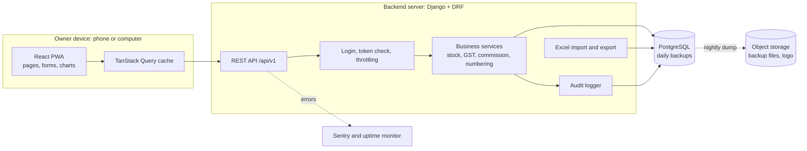

### 16.2 Deployment view

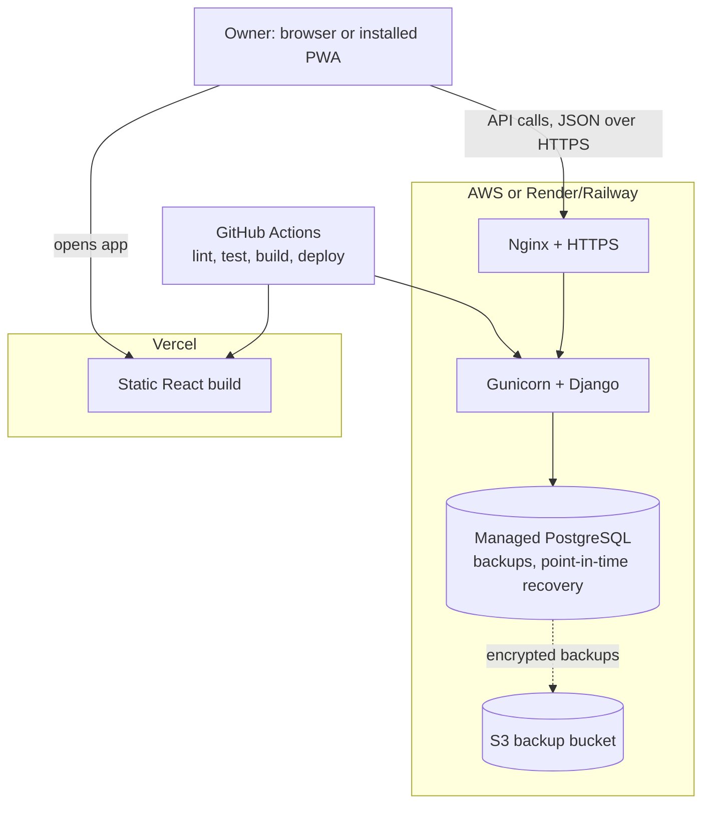

### 16.3 Site map (menus and pages)

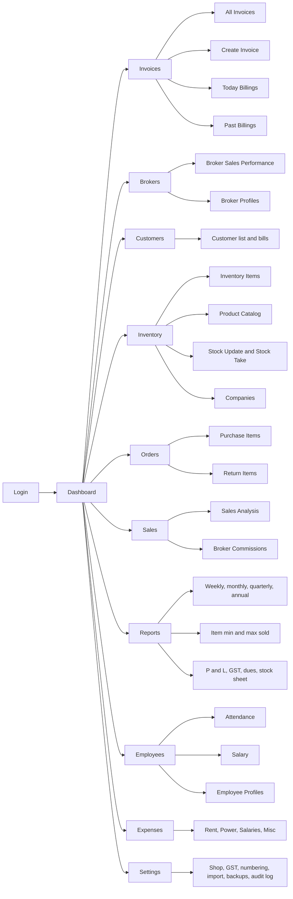

### 16.4 Data flow diagram, level 0 (who talks to the system)

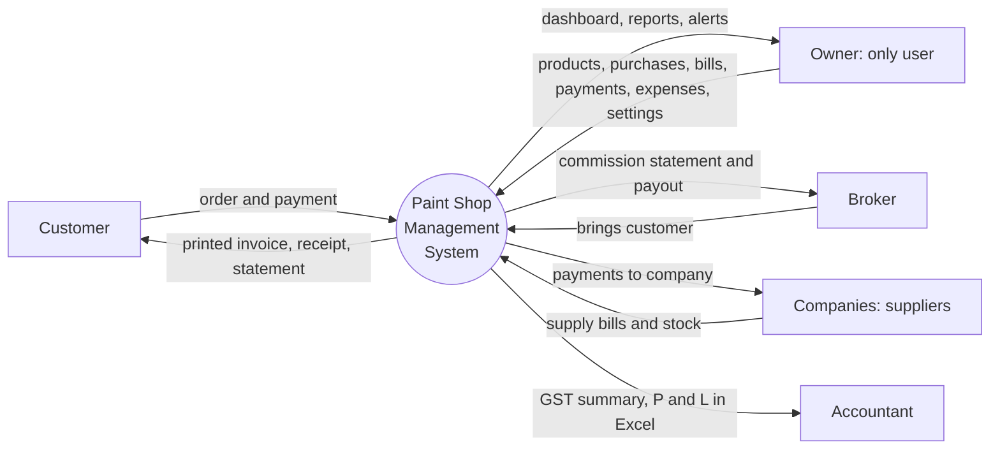

### 16.5 Data flow diagram, level 1 (processes and data stores)

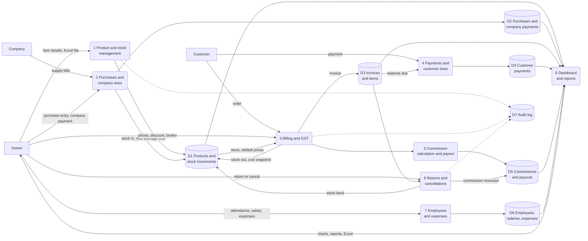

### 16.6 Entity relationship diagram: trading core

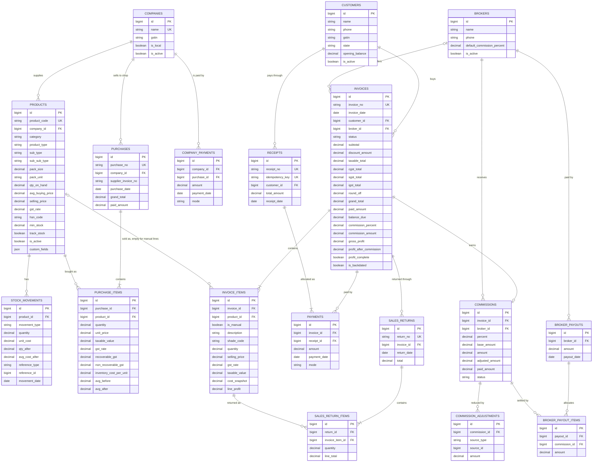

### 16.7 Entity relationship diagram: supporting tables

```mermaid
erDiagram
    EMPLOYEES ||--o{ ATTENDANCE : "marked daily"
    EMPLOYEES ||--o{ SALARIES : "paid monthly"
    SALARIES |o--o| EXPENSES : "creates expense when paid"
    EXPENSE_CATEGORIES ||--o{ EXPENSES : "groups"
    EXPENSE_CATEGORIES ||--o{ RECURRING_EXPENSES : "groups"
    STOCK_TAKES ||--|{ STOCK_TAKE_ITEMS : "contains"
    PRODUCTS ||--o{ STOCK_TAKE_ITEMS : "counted"
    PRODUCTS ||--o{ STOCK_SNAPSHOTS : "month-end value"
    USERS ||--o{ AUDIT_LOG : "actions recorded"

    EMPLOYEES {
        bigint id PK
        string name
        decimal base_salary
        date joining_date
        boolean is_active
    }
    ATTENDANCE {
        bigint id PK
        bigint employee_id FK
        date attendance_date
        string status
    }
    SALARIES {
        bigint id PK
        bigint employee_id FK
        string month
        decimal net_payable
        string status
        bigint expense_id FK
    }
    EXPENSE_CATEGORIES {
        bigint id PK
        string name UK
    }
    EXPENSES {
        bigint id PK
        bigint category_id FK
        decimal amount
        date expense_date
        string source
    }
    RECURRING_EXPENSES {
        bigint id PK
        bigint category_id FK
        decimal amount
        int day_of_month
    }
    STOCK_TAKES {
        bigint id PK
        string take_no UK
        date take_date
        string status
    }
    STOCK_TAKE_ITEMS {
        bigint id PK
        bigint take_id FK
        bigint product_id FK
        decimal system_qty
        decimal counted_qty
    }
    STOCK_SNAPSHOTS {
        bigint id PK
        date snapshot_date
        bigint product_id FK
        decimal qty
        decimal avg_cost
    }
    USERS {
        bigint id PK
        string username UK
        boolean is_active
    }
    AUDIT_LOG {
        bigint id PK
        datetime timestamp
        string action
        string entity_type
        bigint entity_id
        json before_json
        json after_json
    }
    APP_SETTINGS {
        bigint id PK
        string shop_name
        string gstin
        boolean prices_include_gst
        boolean purchase_gst_recoverable_default
    }
    GST_RATES {
        bigint id PK
        decimal rate UK
        boolean is_active
    }
    NUMBER_SERIES {
        bigint id PK
        string series_code
        string financial_year
        int last_number
    }
    IMPORT_JOBS {
        bigint id PK
        string entity
        string status
        int total_rows
        int error_rows
    }
    BACKUP_LOG {
        bigint id PK
        string backup_type
        string status
    }
```

### 16.8 Invoice creation flow (what happens on the billing screen)

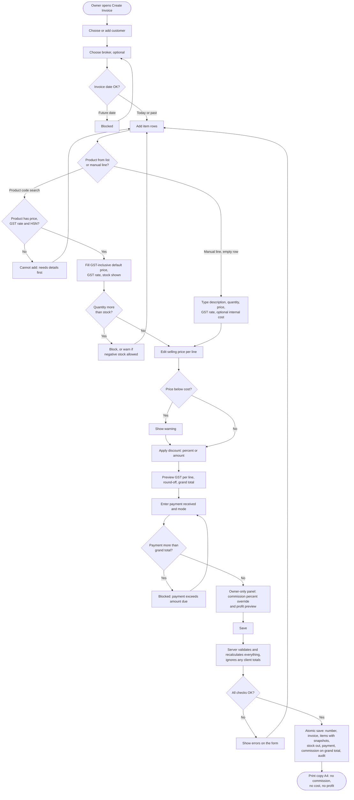

### 16.9 Invoice save: sequence between screen, server and database

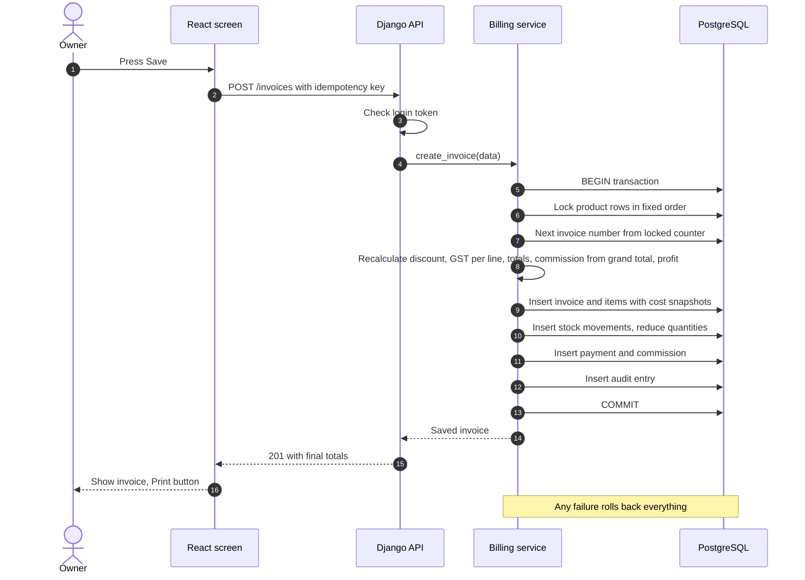

### 16.10 Purchase and weighted average cost

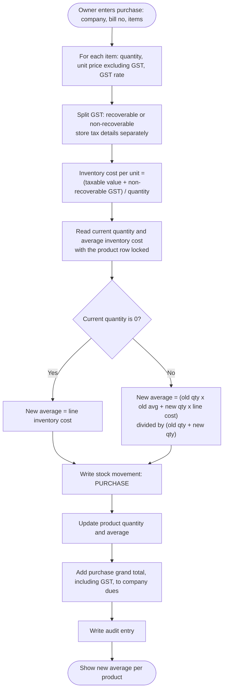

### 16.11 Sales return and invoice cancellation

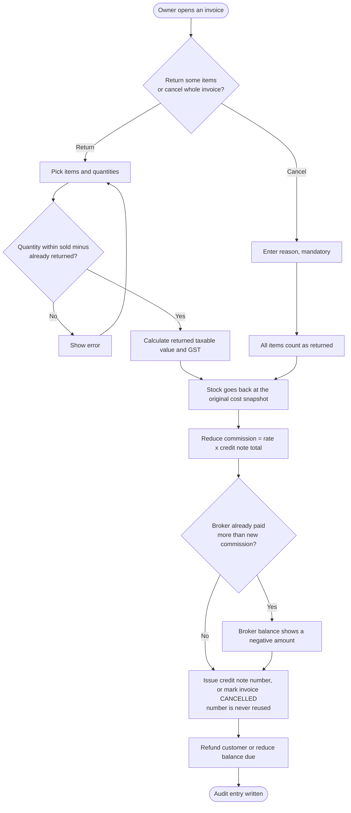

### 16.12 Status life cycles

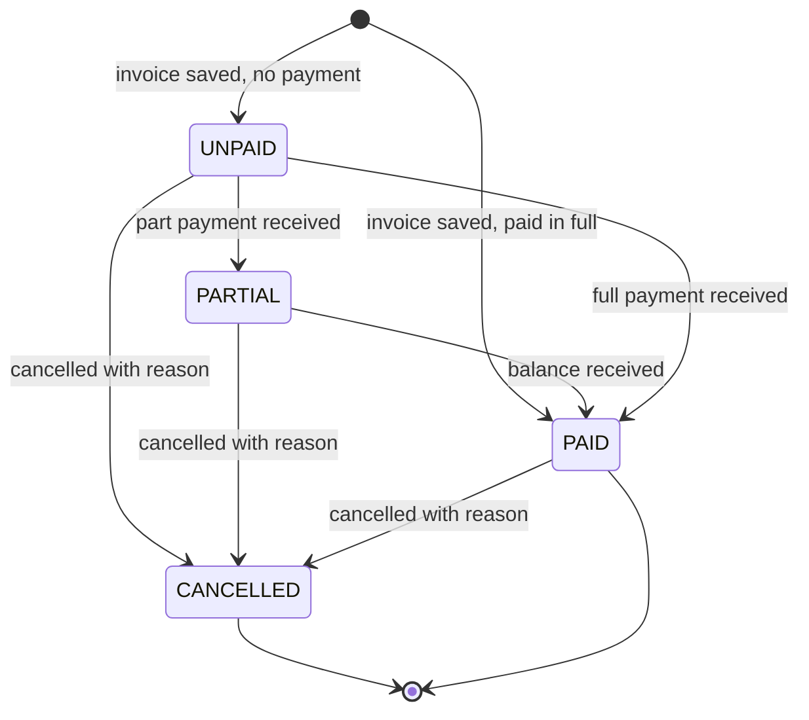

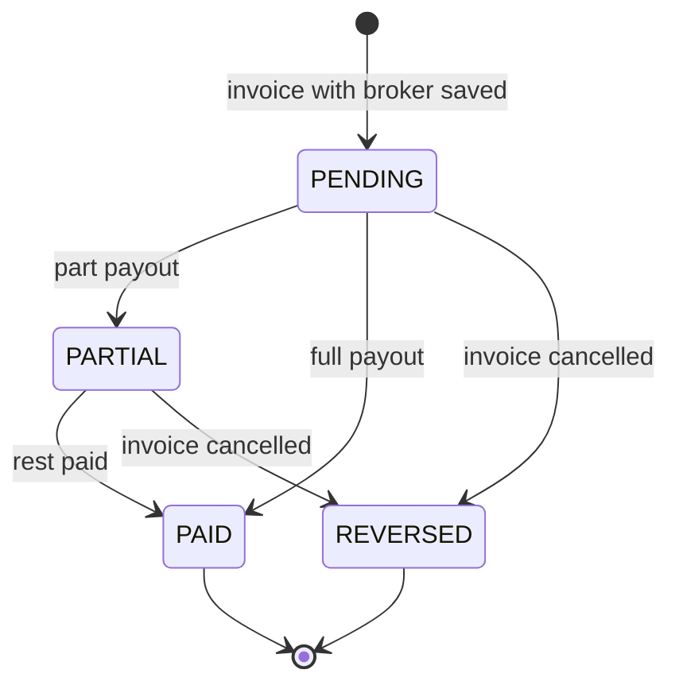

### 16.13 Excel import flow (product and opening stock)

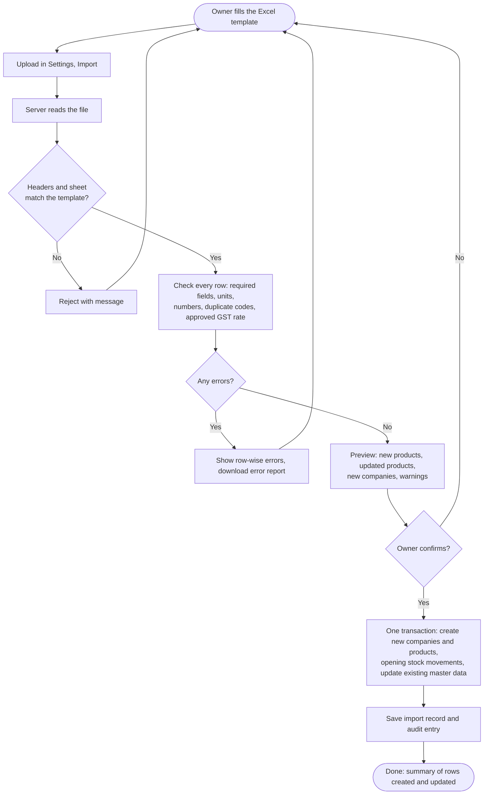

### 16.14 API map

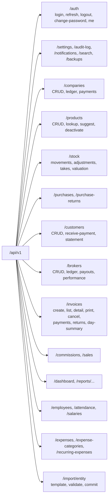

### 16.15 Login and token refresh

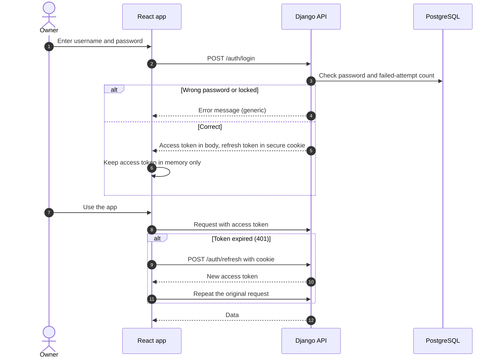

### 16.16 Roadmap timeline (single developer, about 20 weeks)

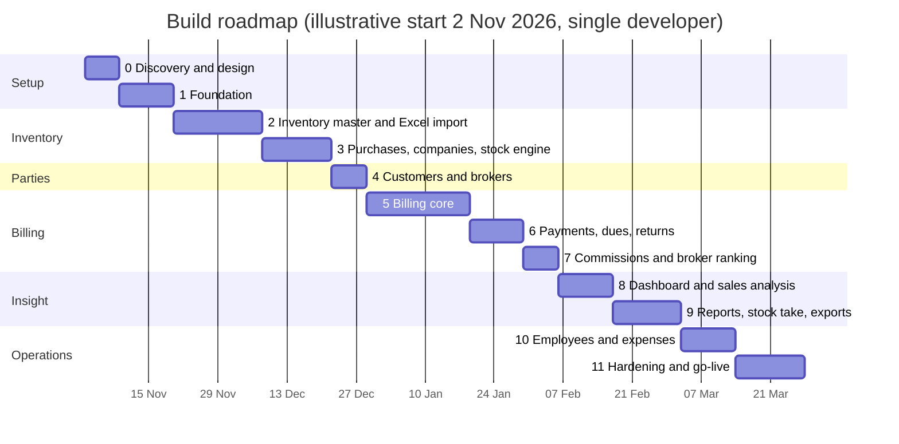

### 16.17 Screen wireframes (plain text)

**Overall layout (about 15% menu, 85% content)**

```
+----------------+--------------------------------------------------------------------+
| [Logo] SHOP    |  [Logo] Shop name   [Calendar]  [ Search........ ]  [+Invoice]     |
| NAME           |                                   [Yesterday] [Bell] [Theme] [Ram] |
+----------------+--------------------------------------------------------------------+
| Dashboard      |                                                                    |
| Invoices     > |                                                                    |
| Brokers      > |                  PAGE CONTENT (85%)                                |
| Customers      |                                                                    |
| Inventory    > |                                                                    |
| Orders       > |                                                                    |
| Sales        > |                                                                    |
| Reports      > |                                                                    |
| Employees    > |                                                                    |
| Expenses       |                                                                    |
| Settings       |                                                                    |
| Logout         |                                                                    |
+----------------+--------------------------------------------------------------------+
```

**Dashboard (as in the reference image)**

```
+--------------------------------------------------------------------+
| Overview                                                           |
| [Total Products] [Invoices] [Total Stock value] [Out of Stock (i)] |
+--------------------------------------------------------------------+
| [Total Customers] | [Pie: sold vs remaining stock] | [Top 10 Brokers] |
+-------------------+--------------------------------+  (bar list)     |
| [Expense vs Profit, last 6 months (area chart)]    |                 |
+----------------------------------------------------+-----------------+
| Optional strip: Today's sales | Today's profit | Customer dues | Commission pending |
+--------------------------------------------------------------------+
```

**Create Invoice**

```
+--------------------------------------------------------------------+
| Invoice No: Auto    Date: [23-10-2026]   Place of supply: [Telangana]|
| Customer: [search or + new......]     Broker: [search, optional.....]|
+--------------------------------------------------------------------+
| Code        | Item details         | Shade | Qty | Price | Disc | GST | Total |
| [type code] | company / type / sub | [   ] | [ ] | [ ]   | [ ]  | 18  | 0.00  |
| [type code] | ...                                                    |
| [manual line: description .......] | [ ] | [price] | [GST] | [cost?] |
| [+ add row]                                                         |
+---------------------------------------+----------------------------+
| Notes (internal)                      | Subtotal            0.00   |
|                                       | Discount  [% or Rs] 0.00   |
| OWNER ONLY (never printed)            | Taxable             0.00   |
| Broker commission %: [10]  Amount 0   | CGST / SGST         0.00   |
| Expected profit 0   After commission 0| Round-off           0.00   |
|                                       | GRAND TOTAL         0.00   |
| Payment received: [____] Mode: [Cash] | Balance due         0.00   |
+---------------------------------------+----------------------------+
|        [ Save ]    [ Save and Print ]    [ Save and New ]           |
+--------------------------------------------------------------------+
```
