# Paint Shop Management System: Complete Project Blueprint

Web and mobile (PWA) application for a paint shop: inventory, billing with GST, customers and dues, broker commissions, employees, expenses, analytics and reports.

**Document status:** Version 4. Version 3 content (product structure, buying and selling price, company tracking, manual invoice lines, Excel import format, diagrams, future-ready design) updated with the **twelve confirmed Version 1 business decisions** (product-wise GST, GST-inclusive prices, commission on the final invoice total, purchase GST costing, back-dating, salary basis, overpayment, A4 printing, numbering, optional category, manual lines). Open decisions are listed in Section 13 and Section 15.10; an AI-assisted build plan is in Section 18 and in the separate file `ai-build-task-planner.md`.

---

## Table of Contents

1. Project Overview and Scope
2. Confirmed Decisions
3. Technology Stack
4. System Architecture
5. UI/UX Specification (from reference image)
6. Business Logic and Rules
7. Database Design
8. Backend API Design
9. Frontend Screens and Behaviour
10. Roadmap (phase by phase, frontend / backend / database)
11. Non-Functional Requirements (security, performance, backups, testing, deployment)
12. Worked Examples
13. Open Items and Assumptions to Confirm
14. Glossary
15. Product Master, Excel Import Format and Resolved Decisions
16. Diagrams (architecture, data flow, ER, flows, API, roadmap, wireframes)
17. Future-Ready Design
18. AI-Assisted Build Plan (pointer)

---

## 1. Project Overview and Scope

### 1.1 Business context
- The shop sells paints (company-branded products in tins/packs measured in litres).
- Customers who want to paint a house usually come through a **broker** (a paint worker/painter who brings customers to the shop).
- At the shop: product list is shown, price is **negotiated**, final bill is made, customer pays (fully or partly), work starts.
- The broker earns a **commission** on the final invoice amount, including GST, after all discounts (default 10-12%, variable per broker and per bill).
- The commission is **never printed on the customer invoice**. It is tracked only inside the app (broker section).

### 1.2 Users
- **One user only:** the shop owner (superadmin). No other logins, no registration, no roles.
- Customers, brokers and employees are **records** in the system, not users.

### 1.3 In scope
Login, dashboard, invoices (create, list, print), customers and dues, brokers and commissions, inventory (items, catalog, stock updates), purchases and returns, sales analysis, reports, employees (attendance, salary), expenses, GST on invoices, shade/colour codes, audit log, invoice numbering, backups, Excel import/export, settings.

### 1.4 Out of scope (version 1)
- Multi-user logins and roles
- Online ordering / e-commerce / customer portal
- Native mobile apps (a PWA is used instead)
- Payment gateway integration
- GST return filing, e-invoice (IRN) and e-way bill integration (the app provides GST summary exports for your accountant)
- Barcode hardware integration (the UI is kept barcode-ready: product code search field accepts scanner input)

---

## 2. Confirmed Decisions

### 2.1 Confirmed for Version 1 (owner decisions; not to be re-asked)

| # | Decision | Detail |
|---|---|---|
| 1 | Single user | One owner login only |
| 2 | Stock costing | **Weighted average inventory cost**. Recoverable GST on purchases is excluded from cost; non-recoverable GST is included (6.3, 6.10) |
| 3 | Product-wise GST | Every product has its own configurable GST rate and HSN code. Different products on one invoice may have different rates. Rates are validated against a configurable approved list (6.5) |
| 4 | GST-inclusive selling prices | Product selling prices are GST-inclusive by default (setting `prices_include_gst`, default on) |
| 5 | Broker commission base | `commission_amount = final invoice total including GST, after all discounts x commission rate / 100`, using the backend-calculated, saved `grand_total` (6.7) |
| 6 | Commission timing | Commission accrues when the invoice is issued and is reversed proportionally for returns and cancellations (6.7, 6.9) |
| 7 | Purchase costing | Purchase tax is stored separately: taxable value, GST, recoverable GST, non-recoverable GST (6.10) |
| 8 | Back-dated invoices | Past invoice dates are allowed and audit-logged; future dates are blocked by default (6.18) |
| 9 | Employee salary | Calendar days is the default basis; attendance, leave, bonus and deductions are configurable (6.14) |
| 10 | Overpayments | Payments above the outstanding due are blocked in Version 1; a customer advance ledger is a future enhancement (6.8) |
| 11 | Invoice printing | A4 in Version 1; 80 mm thermal printing deferred (9.4) |
| 12 | Invoice numbering | Starts at `INV/26-27/0001` unless existing paper numbers must be continued (starting number is a setting); server-generated, gap-free, never reused after cancellation (6.11) |
| 13 | Product category | Optional. Required product fields: company, product type, product code, pack size and unit (6.1) |
| 14 | Manual invoice lines | Non-stock manual lines with an optional internal cost for profit reporting (15.6) |

### 2.2 Earlier confirmed decisions (still valid)

| # | Decision | Detail |
|---|---|---|
| 15 | Deactivation | Brokers, employees, and records with history are deactivated, never deleted |
| 16 | Shade/colour codes | Captured per invoice line |
| 17 | Customer dues | Partial payments and credit sales tracked |
| 18 | Backups | Automatic daily backups plus a restore procedure |
| 19 | Excel | Import and export; the owner prepares data in the application's template |
| 20 | Audit log | Every important change recorded |
| 21 | UI and layout | Follows the reference dashboard image; left menu about 15% |
| 22 | Performance | Lightweight frontend, no heavy animation or processing in the browser |
| 23 | Prices | Each product holds a buying price and a selling price |
| 24 | Product hierarchy | Company, product type (Walmasta, Bison...), sub type (base code), optional sub-sub type, product code |
| 25 | Companies | Separate companies tracked: stock, purchases, payments, dues, sales and profit |
| 26 | Hardware | Bought and sold in pieces; same GST invoice as paints |
| 27 | Future | API-first, versioned, configurable, extensible design (Section 17) |

### 2.3 Assumptions (not owner-confirmed) and future enhancements
Assumptions and unresolved items are kept separate in **Section 13** (open decisions) so that nothing unresolved is treated as approved. Future enhancements (customer advance ledger, thermal printing, staff logins, branch stock) are listed in Section 17.

---

## 3. Technology Stack

### 3.1 Summary

| Layer | Choice | Why |
|---|---|---|
| Frontend | **React 18 + Vite** | Fast build, small bundle, as you requested |
| Routing | React Router | Standard, light |
| Server data | TanStack Query | Caching, fewer loading states, fast navigation |
| Forms | React Hook Form + Zod | Light, fast, strong validation |
| Styling | Tailwind CSS (or plain CSS modules) | Small CSS output, consistent design |
| Charts | Recharts (lazy loaded) | Needed for the pie, bar and area charts in the reference UI |
| Icons | lucide-react | Tree-shaken, only used icons are bundled |
| Dates | dayjs | Very small |
| PWA | vite-plugin-pwa | Installable on phone, no separate app |
| Backend | **Python 3.12, Django 5, Django REST Framework** | Strong transactions, ORM, admin panel, migrations, Excel libraries |
| Auth | SimpleJWT | Short-lived access token plus refresh |
| Filtering | django-filter | List filters |
| Excel | openpyxl (and pandas where useful) | Import/export |
| Database | **PostgreSQL 16** | ACID, exact decimals, row locking, strong reporting queries |
| App server | Gunicorn behind Nginx | Standard production setup |
| Cloud | Frontend on Vercel; backend on AWS (Lightsail/EC2) or Render/Railway; DB on AWS RDS (or Neon/Supabase) | See 3.3 |
| Monitoring | Sentry (errors), UptimeRobot (uptime) | Simple and cheap |

### 3.2 Why not the alternatives
- **Node.js (NestJS/Express):** fine, but you must assemble auth, admin, migrations and validation yourself. Django gives these built in.
- **MongoDB:** billing, stock and commissions are highly relational and need strict consistency. PostgreSQL fits better.
- **Heavy UI kits and animation libraries:** rejected to keep the frontend light.
- **Redux:** not needed. Server data lives in TanStack Query; small UI state uses React state/context.
- **Celery/Redis queues:** not needed for one shop. Imports, backups and reports run as direct requests or scheduled commands.

### 3.3 Hosting notes
- Vercel suits the static React build. It is **not** suited to Django (long-running Python server), so the backend runs on a small server or a managed platform.
- Starting size: one small server (1-2 GB RAM) and a small managed PostgreSQL instance is enough for one shop.
- Managed PostgreSQL gives automated backups and point-in-time recovery.
- Use HTTPS everywhere. The database must not be publicly reachable.

---

## 4. System Architecture

### 4.1 Overview

```
+---------------------------+        HTTPS / JSON (REST)        +--------------------------------+
|  React PWA (Vercel)       | <-------------------------------> |  Django + DRF API (AWS/Render) |
|  - Pages, forms, charts   |   JWT access token (in memory)    |  - Auth, business rules        |
|  - TanStack Query cache   |   refresh token (httpOnly cookie) |  - Stock engine, GST, commission|
+---------------------------+                                   |  - Excel import/export          |
                                                                |  - Audit logging                |
                                                                +---------------+----------------+
                                                                                |
                                                                   SQL (private network)
                                                                                |
                                                                +---------------v----------------+
                                                                |  PostgreSQL 16 (managed)        |
                                                                |  - Daily backups + PITR          |
                                                                +---------------+----------------+
                                                                                |
                                                                +---------------v----------------+
                                                                |  Object storage (S3)            |
                                                                |  - Backup files, shop logo       |
                                                                +--------------------------------+
```

### 4.2 Principles
1. **All business rules live in the backend** (stock cost, GST, commission, numbering, profit). The frontend only shows previews for convenience; the backend recalculates and is the source of truth.
2. **Transactions:** creating an invoice is one atomic operation (invoice, items, stock movements, payment, commission, audit log, number). It fully succeeds or fully rolls back.
3. **Immutable history:** stock movements, audit logs and issued invoices are never edited. Corrections are made with cancellations, returns or adjustments.
4. **Snapshots:** invoices keep copies of product name, code, prices, GST rate and cost at the time of sale.
5. **Money:** `DECIMAL`, never floating point. Rounding rule: half-up to 2 decimals at line level.
6. **Soft deactivation:** records with history are deactivated, not deleted.
7. **Server-side pagination, filtering and sorting** on every list.
8. **Idempotent saves:** the invoice create call carries a client-generated key so a double click or a retry never creates two invoices.

### 4.3 Backend app structure (Django apps)

| App | Responsibility |
|---|---|
| `core` | Settings, number series, audit log, import/export framework, notifications, backup log |
| `accounts` | Single owner login, password change, throttling |
| `catalog` | Companies, products |
| `stock` | Stock movements, weighted average engine, adjustments |
| `purchasing` | Purchases, purchase returns |
| `parties` | Customers, brokers |
| `billing` | Invoices, items, payments, sales returns, GST calculation |
| `commissions` | Commission records, broker payouts, performance |
| `hr` | Employees, attendance, salaries |
| `finance` | Expenses, recurring expenses |
| `analytics` | Dashboard, sales analysis, reports |

### 4.4 API conventions
- Base path `/api/v1/`, JSON only.
- Pagination: `?page=1&page_size=25` (max 100).
- Search: `?search=`, filters as named query params, ordering: `?ordering=-created_at`.
- Money and quantities returned as **strings** (e.g. `"5313.56"`) to avoid float errors.
- Dates in ISO format (`YYYY-MM-DD`), timestamps in UTC; displayed in IST on the frontend.
- Error format: `{ "code": "INSUFFICIENT_STOCK", "message": "...", "fields": { "items[0].quantity": "Only 3 in stock" } }`.
- Every create/update/cancel call writes to the audit log.

---

## 5. UI/UX Specification (from the reference image)

The reference is an "Inventory Management Dashboard" design with a dark teal-blue left sidebar, soft rounded cards on a light blue background, and muted blue/green/orange chart colours. Your application keeps this **visual style and dashboard layout**, with **your menu structure and header requirements**.

### 5.1 What the reference image contains

| Region | In the image | In our app |
|---|---|---|
| Sidebar | Dark teal-blue panel, profile photo, name and email at top, menu list, active item shown as a light pill that merges into the page, Logout at bottom | Same style. Width about 15%. Profile name goes in the header (per your requirement); sidebar top shows shop logo and name area on small screens. Menu items as per Section 5.4. Logout at bottom |
| Header | "Welcome Nirmal!" greeting, search box with icon, light/dark toggle, notification bell | Shop logo + shop name (left), date calendar, global search, **Create Invoice** icon, **previous day sales** icon, notification bell, theme toggle, profile name (right) |
| Overview row | 4 cards: Total Products, Orders, Total Stock, Out of Stock (orange tint, info icon) | Total Products, Invoices, Total Stock, Out of Stock (info tooltip lists items) |
| Customers card | "No of users: Total Customers 583K" | Total Customers |
| Pie chart | "Inventory Values", Sold units vs Total units (32% / 68%) | Sold vs Remaining stock |
| Bar list | "Top 10 Stores by sales" horizontal bars with values | **Top 10 Brokers by sales** (with period switch) |
| Area/line chart | "Expense vs Profit, Last 6 months", with "Highest Expense" and "Highest Profit" markers | Same, with real expense and profit data |

### 5.2 Visual style (approximate, sampled by eye; refine from the design file)

| Item | Value |
|---|---|
| Sidebar background | Dark teal-blue `#27566B` |
| Page background | Light blue `#D9E9F2` (the poster uses a light-to-mid blue gradient; use flat colour in the app) |
| Card background | Near white `#F5FAFD`, radius 12-16 px, thin border, very light shadow |
| Primary text | Dark navy-teal `#1F4457` |
| Muted text | `#5F7F91` |
| Active menu pill | Light `#EAF3F8` text dark teal |
| Chart colours | Dark slate blue `#4F7A93`, light blue `#A9C3D3`, green `#4E9C86`, brown-orange `#C2784F` |
| Overview card accents | Green outline for normal cards, orange/red tint (`#FBEAE2`, border `#E8A98A`) for Out of Stock |
| Font | Rounded humanist sans (Nunito-like). Use `Nunito` via Google Fonts with a system fallback, or system fonts only if you want zero font download |
| Corner radius | Cards 12-16 px, inputs 8 px, buttons 8 px |
| Spacing | 8 px grid |

### 5.3 Layout rules
- Desktop: sidebar fixed at 15% (min 200 px, max 260 px), content scrolls independently; header fixed on top of content.
- Tablet: sidebar collapses to icons.
- Mobile: sidebar becomes a slide-in drawer opened by a menu button; cards stack in one column; tables turn into compact card lists.
- Page content max width about 1400 px.

### 5.4 Navigation structure (final)

```
Dashboard
Invoices
  - All Invoices
  - Create Invoice
  - Today Billings
  - Past Billings
Brokers
  - Broker Sales Performance
  - Broker Profiles (add / edit / deactivate)
Customers
  - Customer list and bill details
Inventory
  - Inventory Items
  - Product Catalog (company dropdown -> company items)
  - Stock Update (purchases, adjustments, stock take)
  - Companies (profiles, purchases, payments, dues, company-wise sales)
Orders
  - Purchase Items
  - Return Items
Sales
  - Sales Analysis
  - Broker Commissions
Reports
  - Weekly / Monthly / Quarterly / Annual
  - Item Min/Max Sold
  - (plus GST, P&L, dues, stock valuation: see 9.12)
Employees
  - Attendance
  - Salary
  - Employee Profiles (add / edit / deactivate)
Expenses
  - Rent, Power, Salaries, Miscellaneous (and custom categories)
Settings (bottom, above Logout)
  - Shop profile, GST, numbering, backups, import/export, audit log, password
Logout
```

The reference image also shows "Purchase", "Reporting" and "Support" items. These map to **Orders > Purchase Items**, **Reports** and (not needed for a one-owner app, so omitted).

### 5.5 Header behaviour
- **Shop logo + name:** loaded from settings. Clicking goes to Dashboard.
- **Calendar (date jump):** a small date picker. Choosing a date opens **Invoices > Past Billings filtered to that date** with a day summary strip (invoices count, sales, collected, profit). The shortcut keeps it a one-step action.
- **Global search:** one box searching product code/name, customer name/phone, broker name, invoice number, shade code. Results grouped (Products, Customers, Brokers, Invoices), top 5 each, with 300 ms debounce.
- **Create Invoice icon:** goes straight to the billing screen.
- **Previous day sales icon:** opens a small popover with yesterday's invoices count, total sales, collected amount and profit, plus a "View invoices" link.
- **Notification bell:** shows counts for out-of-stock/low-stock items, overdue customer dues, pending broker commission and any failed backup. Computed on request; no separate notifications table.
- **Theme toggle:** light/dark using CSS variables (delivered in the polish phase).
- **Profile name:** shows the owner's username; dropdown with Change Password and Logout.

### 5.6 Performance-oriented UI rules
- No animation libraries; only simple CSS transitions (hover, focus). No page transition animations.
- Charts are lazy loaded (only on Dashboard/Sales/Reports).
- Route-based code splitting.
- Initial JavaScript target below about 200 KB gzipped.
- Tables use server pagination (25 rows default); long dropdown lists use search-as-you-type, not loading everything.
- Skeleton placeholders (static grey blocks) instead of spinners where helpful.

---

## 6. Business Logic and Rules

### 6.1 Product structure
A **product** is one sellable item with one size. In this document the older word "pack" means one sellable **unit** (a tin, a bag or a piece). The final field list, with examples, is in **Section 15.3**; the summary is:

| Field | Required | Notes |
|---|---|---|
| Product code | **Yes** | Unique (case-insensitive). Primary key for searching, filtering and billing lookup |
| Company | **Yes** | From the companies list |
| Product type | **Yes** | Product name, e.g. Walmasta, Bison, Blade, Sandpaper |
| Pack size + unit | **Yes** | e.g. 20 LTR, 100 ML, 40 KG, 1 PCS |
| Category | No | Optional report group (Paint, Hardware...) |
| Sub type | No (usually filled) | Base code (PO, P1, N1...) or size/roughness for hardware |
| Sub-sub type | No | Any additional detail |
| Quantity on hand | System | In units; changed only by stock transactions |
| Average buying price (inventory cost) | System | Weighted average inventory cost per unit (see 6.3) |
| Selling price | No at creation; **needed before billing** | GST-inclusive default price per unit |
| GST rate and HSN code | No at creation; **needed before billing** | Per product; GST rate must be one of the approved rates (6.5) |
| Minimum stock level | No | Low stock alert threshold |
| Track stock / Active | Yes (defaults Y) | Deactivate instead of delete |

**Billing readiness:** a product can be created and imported without selling price, GST rate or HSN code (so the master list can be loaded before the owner supplies verified tax data), but it **cannot be added to an invoice or purchase until those fields are set**. The product list shows a "Needs tax/price details" badge for such items. Opening stock quantity above zero requires a buying price.

Derived (always calculated): stock value = quantity x average inventory cost; litres = quantity x pack size for LTR/ML products only.

Type, sub type and sub-sub type are saved with **autocomplete** and compared ignoring capital letters and extra spaces.

### 6.2 The four price terms

| Term | Meaning | Example (one tin) |
|---|---|---|
| Inventory cost (average buying price) | Weighted average cost per unit, excluding recoverable GST and including non-recoverable GST (see 6.3) | 350 |
| Default selling price | Standard **GST-inclusive** price auto-filled on the invoice | 450 |
| Selling price (on invoice line) | Final negotiated **GST-inclusive** price for this customer | 420 |
| Cost snapshot | Copy of the inventory cost saved on the invoice line at the time of sale | 350 |

Profit per line = (taxable selling value, excluding GST) minus (quantity x cost snapshot). The snapshot guarantees that old invoices keep their original profit even when later purchases change the cost.

### 6.3 Weighted average cost (stock costing)

Each product holds `qty_on_hand` (units) and `avg_buying_price`, defined as the **average inventory cost per unit**.

**Inventory cost of a purchase line** = (taxable value + non-recoverable GST) / quantity. Recoverable GST is **not** part of inventory cost; it is stored separately on the purchase (6.10).

| Event | Quantity | Average inventory cost |
|---|---|---|
| Opening stock | + qty | = entered buying price (taken as inventory cost: excluding recoverable GST) |
| Purchase | + qty | `new_avg = (old_qty x old_avg + in_qty x line_inventory_cost) / (old_qty + in_qty)`. If old_qty is 0, new_avg = line_inventory_cost |
| Sale | - qty | Unchanged. The invoice line stores `cost_snapshot = current avg` |
| Sale return / invoice cancellation | + qty | Treated like a purchase at the **original cost snapshot** (average recalculated) |
| Purchase return | - qty | **Provisional rule, needs accountant approval (13.14):** valued at the inventory cost of the purchase line being returned (or the current average if no purchase is referenced); `new_avg = (old_qty x old_avg - ret_qty x ret_cost) / (old_qty - ret_qty)`; when quantity reaches 0 the last average is kept |
| Adjustment in (found stock) | + qty | Valued at the current average (average unchanged) |
| Adjustment out (damage, leakage, loss, opened pack) | - qty | Average unchanged |
| Stock take difference | +/- qty | Same as adjustment in/out |

**Consistency rule:** one costing policy is used everywhere. Stock valuation = quantity x average inventory cost; cost of goods sold (COGS) = quantity sold x cost snapshot (the average at the moment of sale); month-end snapshots, stock take differences and company-wise stock value all use the same average. Returns reverse COGS at the original snapshot.

**Your example (prices excluding GST, GST recoverable):** last month 10 tins at 300, this month 10 tins at 400. `(10 x 300 + 10 x 400) / 20 = 350` per tin. Every tin sold is costed at 350 until the next purchase changes the average. If GST on those purchases were **non-recoverable** at 18%, the inventory costs would be 354 and 472 and the average 413 (see 12.1).

**Other rules**
- Negative stock is **blocked** by default (setting `allow_negative_stock`, default off).
- Stock changes are done while holding a **row lock** on the product (`SELECT ... FOR UPDATE`, rows locked in a fixed order) so two bills can never sell the same last tin.
- Average cost is stored per unit with 4 decimal places to limit rounding drift.
- Every change is written to `stock_movements` with quantity and average after, so stock can be audited and rebuilt.
- Manual invoice lines never touch stock or average cost (15.6).

### 6.4 Invoice calculation (order of operations)

**Who calculates:** the backend only. The client sends inputs (items, quantities, selling prices, discounts, optional commission rate override, payment). It never sends totals, GST amounts, commission base or commission amount; the backend recalculates everything, saves it, and returns the saved values. The screen may show a live preview using the same formulas.

**Price basis:** product selling prices are **GST-inclusive** by default (setting `prices_include_gst`, default on). The exclusive mode is an optional configuration; the formulas for both are below. Rounding policy (unchanged): **half-up to 2 decimals at line level**.

For each line `i` (GST rate `r_i` is the rate stored on the line, which may differ from line to line):
1. `gross_i = quantity_i x selling_price_i`
2. `net_i = gross_i - line_discount_i` (line discount optional)
3. **Invoice discount allocation:** the invoice discount `D` (percent or amount) is allocated across lines in proportion to `net_i`: `allocation_i = round(D x net_i / sum(net))`; the **last line takes the rounding remainder** so allocations add up exactly to `D`. `discounted_i = net_i - allocation_i`. Allocation works on GST-inclusive amounts, so mixed GST rates are handled correctly.
4. GST (per line, at that line's rate):
   - Prices include GST: `taxable_i = round(discounted_i / (1 + r_i/100))`, `gst_i = discounted_i - taxable_i`
   - Prices exclude GST: `taxable_i = discounted_i`, `gst_i = round(taxable_i x r_i/100)`
5. Split GST by place of supply (6.5):
   - Same state: `cgst_i = round(gst_i / 2)`, `sgst_i = gst_i - cgst_i`
   - Different state: `igst_i = gst_i`
6. `grand_total_unrounded = sum(taxable_i + gst_i)`; `round_off = round(grand_total_unrounded) - grand_total_unrounded` (nearest rupee); `grand_total = grand_total_unrounded + round_off`. This **saved `grand_total`** is the "final invoice amount".
7. `balance_due = grand_total - payments received`

**Snapshots saved on every line:** product code and name, HSN code, GST rate, selling price, default price, discount allocation, taxable value, CGST/SGST/IGST amounts, line total and cost snapshot. Later changes to a product's price, GST rate or HSN code never change issued invoices.

**Profit and commission use the saved values:**
- `line_profit_i = taxable_i - quantity_i x cost_snapshot_i` (taxable value excludes GST; GST is never counted as profit)
- Manual lines without an internal cost have **no profit figure** (not zero); the invoice is marked `profit_complete = false` and the revenue of such lines is shown as `unknown_cost_taxable_value`
- `gross_profit = sum(line_profit_i)` over lines whose cost is known
- `commission_amount = round(grand_total x commission_percent / 100)` (6.7)
- `profit_after_commission = gross_profit - commission_amount` (commission is **not** subtracted from the GST-inclusive total; it is an expense against gross profit)

### 6.5 GST rules
- **Product-wise GST:** every product stores its own GST rate and HSN code. There is no single shop-wide rate. One invoice may contain lines with different rates.
- **Approved rates:** GST rates are validated against a configurable list of approved rates (`gst_rates`, Settings > GST rates). The list is maintained by the owner or accountant; no product rates are assumed by the system. A product, purchase line, manual line or Excel row with a rate not on the list is rejected.
- **Verified data is supplied by the owner:** actual product GST rates, HSN codes, shop GSTIN and shop state stay configurable and may be blank until the owner provides verified values. A product without GST rate and HSN is not billing-ready (6.1) and cannot be sold.
- **Place of supply:** defaults to the customer's state; if none, the shop state. Shop state code and customer state code decide CGST+SGST (same state) versus IGST (different state). GSTIN format is validated and, when present, its state code is compared with the selected state (warning on mismatch). The owner or accountant should verify these rules for the shop's situation.
- **Customers:** without GSTIN the sale is B2C; with GSTIN the invoice shows it (B2B).
- **Snapshots and immutability:** each invoice line stores the applied GST rate, HSN code, taxable value, CGST, SGST and IGST. Changing a product's GST rate or HSN later does not modify previously issued invoices, credit notes or reports.
- **Manual lines** carry their own GST rate (chosen from the approved list; an optional default can be set in Settings).
- The invoice shows: taxable value and GST per rate, CGST/SGST or IGST, round-off, grand total, and the amount in words.
- The GST summary report groups output GST by rate and input GST (from purchases, split into recoverable and non-recoverable) for your accountant.

### 6.6 Shade / colour codes
- Each invoice line has optional **shade code** and **shade name** (text), printed on the invoice.
- Stock is **not** tracked per shade (tinting is done on demand from the base product).
- Shade code is searchable (invoice list, global search) so a customer's earlier shade can be found for repeat orders.
- Customer detail shows previously used shades.

### 6.7 Broker commission

**Confirmed formula (Version 1):**

`commission_amount = final_invoice_total_including_gst_after_discounts x commission_rate / 100`

Example: final invoice amount (including GST, after discounts) 10,000 and rate 10% gives commission **1,000**.

- **Base:** the saved, backend-calculated `grand_total` of the invoice (6.4). It is never supplied or edited by the client. The old `commission_base` setting and its two modes are removed.
- **Rate:** the broker's default rate (settings default 10%, allowed range 0-100%) is copied to the invoice and can be overridden per invoice where authorized (single owner in Version 1; a permission `commission.override` is reserved for future roles). The applied rate and the calculated amount are saved as **historical snapshots** on the commission record; later changes to the broker's default never alter old invoices.
- **Accrual:** commission accrues when the invoice is issued (`commissions` row created in the same transaction as the invoice). There is no "release after full payment" rule in Version 1.
- **Visibility:** never shown on the customer invoice or print; visible only on the owner panel of the billing screen and in the broker section.
- **Status:** `PENDING` -> `PARTIAL` -> `PAID`, and `REVERSED` when the whole commission is reversed.
- **Payouts:** the owner records a payout (amount, date, mode); the system allocates it to the oldest pending commissions first. A payout cannot exceed the broker's pending commission.
- **Reversals (returns and cancellations):** every reversal is saved as a `commission_adjustments` row (negative amount, source return or cancellation, date). For a credit note: `reversal = round(commission_percent_snapshot x credit_note_total / 100)`, never more than the commission still outstanding on that invoice (the final return takes any rounding remainder). A cancellation reverses the whole remaining commission. `commissions.adjusted_amount = amount + sum(adjustments)`.
- **Already paid:** if the broker has been paid more than the adjusted commission, the broker's balance shows a negative amount (recoverable); no automatic clawback is made.
- **Deactivated brokers** keep all history; they cannot be selected on new invoices.

**Commission as an expense (profit reporting):** commission is an expense recognised **when it accrues** (invoice date) and reduced by reversals (return or cancellation date). **Payouts are not expenses**; they only settle the liability. Reports therefore show three separate figures: commission expense (accrued net of reversals), commission paid, commission pending. Because payouts are excluded from expenses and reversals are separate adjustment rows, commission is never counted twice.

### 6.8 Customer dues
- Invoice `payment_status`: `UNPAID`, `PARTIAL`, `PAID`, `CANCELLED`.
- Payments: cash, UPI, card, bank transfer, cheque, with reference and note.
- A payment can be recorded at billing time or later on the invoice.
- **Receipts and allocations:** every money receipt is saved as a `receipts` header (receipt number, customer, amount, date, mode) with one `payments` row per invoice it settles (the allocation). A receipt entered on the customer page is split across that customer's oldest unpaid invoices.
- **Overpayments are blocked in Version 1:** a payment (or the total of a customer receipt) cannot exceed the outstanding due of the invoice(s) it is applied to. The server checks this while holding a lock on the invoice and returns `PAYMENT_EXCEEDS_DUE`. Customer advances (money received before a bill exists) need a separate customer ledger and are a future enhancement.
- Customer outstanding = opening balance + sum of invoice balances.
- The customer opening balance field supports dues that existed before using the app.
- Overdue = unpaid balance older than N days (setting `overdue_days`, default 30); shown on dashboard/notifications and in the dues ageing report (0-30, 31-60, 61-90, 90+).
- Receipts carry an idempotency key so a double click or retry never records a payment twice.
- Optional: "Send reminder" button that opens a WhatsApp/SMS link with a prefilled message.

### 6.9 Returns and cancellations

**Sales return (credit note):** against an invoice, choose items and quantity (cannot exceed sold minus already returned). All amounts are taken from the **stored invoice line snapshot**, never from current product data:
- **Revenue (excluding GST):** `returned_taxable = round(line.taxable_value x returned_qty / line.quantity)`; GST (CGST/SGST/IGST) is reversed in the same proportion. When the cumulative returned quantity equals the sold quantity, the return takes the remainder, so credit notes always add up exactly to the original line.
- **Credit note total** = returned taxable + returned GST (+ its own round-off to the nearest rupee). Credit notes use their own number series (`CN`).
- **Stock:** returned quantity goes back at the original **cost snapshot** (average recalculated, 6.3). **COGS** is reduced by `returned_qty x cost_snapshot`, so gross profit is reduced by the revenue reversed minus the cost reversed.
- **Commission:** reduced as described in 6.7 using the credit note total. The credit note itself never creates a commission.
- **Money:** the customer's balance due on the invoice is reduced first; any remaining credit is refunded (`REFUNDED` payment, not more than the amount actually received on that invoice). Refund as customer credit/advance is not available in Version 1.
- **Manual lines:** can be returned for revenue and GST reversal; they have no stock effect and a COGS reversal only if an internal cost was entered.

**Invoice cancellation:** allowed for the owner with a mandatory reason. Effects: every line counts as returned (same rules as above, one cancellation record), stock restored, commission fully reversed, payments marked refunded, invoice marked `CANCELLED`, **its number is never reused**.

**Invoices are not edited after saving.** To fix a mistake: cancel and recreate, or issue a return. This keeps GST records and profit history reliable.

**Purchase return:** returns stock to the company with its GST reversed; valuation follows the provisional rule in 6.3 (accountant approval pending, 13.14). Amounts reduce the company dues.

**No duplicate effects:** invoices, receipts, returns, payouts and purchases each carry an idempotency key with a unique constraint, and every stock, payment and commission effect is written inside the same database transaction as its document.

### 6.10 Purchases (stock in)
- Header: company, supplier invoice number, purchase date, supplier state (for CGST/SGST versus IGST), notes.
- Each line: product, quantity, **unit price excluding GST**, GST rate (from the approved list), and an **ITC eligible** flag (default from the setting `purchase_gst_recoverable_default`, to be confirmed with the accountant, 13.13).
- Per line the system calculates and **stores separately**: `taxable_value`, `cgst/sgst/igst`, `gst_amount`, `recoverable_gst`, `non_recoverable_gst`, `inventory_cost_total = taxable_value + non_recoverable_gst`, `inventory_cost_per_unit`, `avg_before`, `avg_after`.
- **Rule:** recoverable GST is excluded from inventory cost; non-recoverable GST is included in inventory cost. The purchase total payable to the company is `taxable + all GST`.
- On save: stock movements created at the line's inventory cost per unit, weighted average updated per product, last buying price recorded, company dues increased by the purchase grand total.
- The GST summary report shows input GST split into recoverable and non-recoverable.
- Payments to the company reduce dues (`company_payments`); a purchase has `payment_status` UNPAID, PARTIAL or PAID.

### 6.11 Invoice numbering
- Format: `INV/26-27/0001` (prefix / financial year / sequence). Financial year starts in April (setting).
- **Starting number:** the series starts at `INV/26-27/0001` unless existing paper invoices need to be continued; in that case the owner enters the next paper number as `series_start_number` for the current financial year before the first invoice (it cannot be lowered after an invoice exists).
- Generated **on the server inside the invoice transaction** using a counter row locked per series and financial year, so there are no gaps or duplicates even with parallel requests.
- The financial year of an invoice is taken from the **invoice date**.
- Separate series: `INV` (invoice), `CN` (sales return / credit note), `PUR` (purchase entry), `RCT` (payment receipt), `PR` (purchase return).
- A cancelled number is **never reused**; the cancelled invoice stays visible.
- The sequence restarts at 0001 at the start of each financial year.
- Back-dated invoices receive the next number in sequence (numbers follow the order of issue, the date shown is the chosen date); the audit log flags them (6.18).

### 6.12 Audit log
Recorded for: login/logout/failed login, create/update/deactivate of every master record, invoice create/cancel, **back-dated invoice creation (with the date entered and the actual time)**, payments, returns, stock adjustments, price and GST changes, commission payouts and reversals, settings changes (including approved GST rates), imports, exports, backups and restores.

Each entry: timestamp, action, entity type, entity id, human summary, **before and after values (JSON)**, IP address. The log is **append-only** (no edit/delete in the application) and viewable in Settings > Audit Log with filters by date, action and entity.

### 6.13 Profit and loss definitions

Three metrics, always kept separate:

| Metric | Definition |
|---|---|
| **Gross profit** | Net sales revenue **excluding GST** (after discounts and returns) minus cost of goods sold (cost snapshots, after return reversals) |
| **Profit after commission** | Gross profit minus broker **commission expense** (accrued commission net of reversals, 6.7) |
| **Net profit** | Profit after commission minus applicable operating expenses (rent, power, salaries, miscellaneous and custom categories) |

Rules:
- Historical invoice prices, discounts, tax snapshots and cost snapshots are used; current product data is never used for past periods.
- GST is never part of revenue or profit.
- Commission is **not** subtracted from the GST-inclusive invoice total; it is an expense against gross profit. Commission payouts are not expenses (6.7), and salary payments appear in expenses once (via the salary record, 6.14).
- Returns reduce revenue, GST, COGS and commission in the period of the credit note.
- Lines without a known cost (manual lines with no internal cost) are excluded from gross profit and shown as **profit incomplete** with the revenue involved, never silently counted as zero cost.
- The dashboard chart "Profit" series is **profit after commission**; the "Expense" series is operating expenses.

### 6.14 Employees
- Profile: name, phone, address, designation, joining date, monthly base salary, active flag (deactivate, never delete).
- Attendance per day: **Present (P), Absent (A), Half-day (HD), Paid leave (PL), Unpaid leave (UL), Holiday (H)** (one record per employee per day). The statuses and the day-weight each earns are configurable in Settings (defaults: P 1, HD 0.5, PL 1, UL 0, A 0, H 1).
- **Default salary basis: calendar days.** `salary = base_salary / days_in_month x paid_days`, where `paid_days` is the sum of the configured day-weights for the month. The basis can be changed in Settings (for example fixed 26 or 30 days).
- Salary adjustments per month: bonus, advance deducted, other deductions (each with a note); `net_payable = salary + bonus - advance - other deductions`.
- Marking a salary as paid automatically creates **one expense entry in the Salaries category** (no double entry).

### 6.15 Expenses
- Default categories: Rent, Power, Salaries, Miscellaneous. The owner can add more categories.
- Fields: category, amount, date, payment mode, note.
- **Recurring expenses** (rent, power): saved with a day of month; when the day arrives, the dashboard/notifications prompt "Rent due: add now?" with one click to create the entry. No background scheduler is needed.

### 6.16 Backups and Excel import/export
**Backups**
- Automatic daily database backup (managed database snapshots/point-in-time recovery, plus a nightly `pg_dump` to encrypted object storage).
- Retention: 7 daily, 4 weekly, 12 monthly.
- Backup status is logged (`backup_log`) and a failure raises a notification.
- A restore test is done monthly. A written restore procedure is part of the handover.
- In-app "Download full data export (Excel/ZIP of CSVs)" gives you your own copy anytime.

**Excel import** (products, customers, brokers, employees, opening stock)
1. Download the template.
2. Upload the file.
3. The system **validates** and shows a preview with row-level errors (duplicate product code, missing fields, bad numbers).
4. The owner confirms; valid rows are committed in one transaction (or the owner chooses to skip invalid rows).
5. An import record is saved and audited. Products are matched by product code (create or update).

**Excel export:** every list and report has an Export button (respects current filters).

### 6.17 Search and filtering
- Products: by code (primary), company, type, sub type, sub-sub type, stock status (in stock, low, out), active flag.
- Invoices: by number, customer, broker, date range, payment status, shade code, product.
- Search fields use PostgreSQL trigram indexes so partial matches stay fast.

### 6.18 Validation rules (key ones)
- **Selling price** must be greater than 0 when set; a **warning** (not a block) appears if the invoice selling price is below cost.
- **Quantity** must be positive and not exceed stock (unless negative stock is allowed). Manual lines are exempt from the stock check.
- **Discount** cannot exceed the invoice subtotal; a confirmation appears above a configurable percentage.
- **Commission percent** between 0 and 100; accepted from the client only as an optional override, never the amount or base.
- **Product:** product code unique; company, product type, pack size and unit required; category optional; GST rate must be on the approved list; HSN code text.
- **Billing readiness:** a product without selling price, GST rate or HSN cannot be added to an invoice (message: "Product needs price, GST rate and HSN before billing").
- **Invoice date:** past dates are allowed and audit-logged as back-dated; **future dates are blocked** (setting `allow_future_invoice_dates`, default off). *Assumption, not owner-confirmed (13.15):* back-dating into a previous financial year is blocked by default (setting `block_prior_fy_backdating`), because it would insert numbers into a closed series.
- **Payments:** a payment or receipt cannot exceed the outstanding due (`PAYMENT_EXCEEDS_DUE`); a refund cannot exceed the amount received on that invoice.
- **Returns:** quantity cannot exceed sold minus already returned.
- **Manual line:** description, quantity, selling price and GST rate (approved list) required; internal cost optional.
- Phone numbers validated (10 digits for India), GSTIN validated by format and state code.

---

## 7. Database Design (PostgreSQL)

### 7.1 Conventions
- Primary keys: `BIGINT` identity. Every table has `created_at`, `updated_at` (timestamps, UTC).
- Money: `DECIMAL(12,2)`. Average cost: `DECIMAL(14,4)`. Quantities: `DECIMAL(10,3)` (in packs; whole numbers normally, fractions only if the product allows).
- Enumerations are stored as short text with `CHECK` constraints.
- Records with history use `is_active` (deactivate), never hard delete.
- Immutable tables: `stock_movements`, `audit_log`, `payments` (corrections are new rows).

### 7.2 Entity relationship overview

```
companies 1---* products 1---* stock_movements
companies 1---* purchases 1---* purchase_items *---1 products
companies 1---* company_payments
customers 1---* invoices 1---* invoice_items *---0..1 products (empty for manual lines)
customers 1---* receipts 1---* payments *---1 invoices          (payments = allocations)
brokers   1---* invoices
invoices  1---1 commissions *---1 brokers
commissions 1---* commission_adjustments                         (reversals from returns/cancellations)
brokers   1---* broker_payouts 1---* broker_payout_items *---1 commissions
invoices  1---* sales_returns 1---* sales_return_items *---1 invoice_items
employees 1---* attendance
employees 1---* salaries ---> expenses
expense_categories 1---* expenses
gst_rates (approved list), number_series, app_settings, audit_log, import_jobs, backup_log (supporting)
```

### 7.3 Tables

**users** (Django auth; exactly one active superuser)
`id, username (unique), password_hash, last_login, is_active`

**app_settings** (single row)
`shop_name, logo_url, address, phone, email, gstin null, state null, state_code null, invoice_prefix, invoice_footer, terms_text, prices_include_gst (default true), default_manual_line_gst_rate null, purchase_gst_recoverable_default (default true, to be confirmed with accountant), commission_default_percent (default 10), commission_override_allowed (default true), allow_negative_stock (default false), allow_future_invoice_dates (default false), block_prior_fy_backdating (default true), financial_year_start_month (default 4), salary_basis (default 'CALENDAR_DAYS'), attendance_weights (json), overdue_days (default 30), discount_warn_percent, idle_logout_minutes, print_format (default 'A4'), theme`

The old `commission_base` setting is removed: commission base is always the invoice `grand_total`.

**gst_rates** (approved GST rates, maintained by the owner or accountant)
`id, rate (decimal(5,2), unique), label, is_active`. Only active rates can be used on products, purchase lines, manual lines and imports. No product rates are assumed.

**companies** (paint companies / suppliers / local group)
`id, name (unique), phone, address, gstin, notes, is_local, is_active`

**company_payments** (append-only)
`id, company_id, purchase_id null, amount, payment_date, mode, reference, note`

**products**

| Column | Type | Notes |
|---|---|---|
| id | bigint PK | |
| product_code | text | **Required, unique**, case-insensitive, indexed |
| company_id | FK companies | **Required** |
| category | text null | optional report group |
| product_type | text | **Required**; e.g. Walmasta, Bison, Blade; indexed |
| sub_type | text null | base code or main variant; indexed |
| sub_sub_type | text null | |
| description | text null | |
| pack_size | decimal(10,3) | **Required**, > 0 |
| pack_unit | text | **Required**: LTR, ML, KG, G, PCS, SET, MTR (extendable list) |
| allow_fractional_qty | boolean | default false |
| qty_on_hand | decimal(10,3) | maintained only by the stock engine |
| avg_buying_price | decimal(14,4) null | **average inventory cost per unit**: excludes recoverable GST, includes non-recoverable GST; required when opening qty > 0 |
| last_buying_price | decimal(14,4) null | information only |
| selling_price | decimal(12,2) null | default per unit, **GST-inclusive** by default; needed before billing |
| gst_rate | decimal(5,2) null | must exist in `gst_rates`; needed before billing |
| hsn_code | text null | needed before billing |
| min_stock | decimal(10,3) null | |
| track_stock | boolean | default true |
| custom_fields | jsonb | extra fields added later |
| is_active | boolean | |

Derived in queries/API: `billing_ready` (selling price, GST rate and HSN present), stock value, litres (LTR/ML products only).

**stock_movements** (append-only)
`id, product_id, movement_type ('OPENING','PURCHASE','SALE','SALE_RETURN','PURCHASE_RETURN','ADJ_IN','ADJ_OUT','CANCEL_REVERSAL'), quantity (signed), unit_cost, qty_after, avg_cost_after, reference_type, reference_id, reason, movement_date`

**purchases**
`id, purchase_no (unique), idempotency_key (unique), company_id, supplier_invoice_no, supplier_state, purchase_date, taxable_total, cgst_total, sgst_total, igst_total, gst_total, recoverable_gst_total, non_recoverable_gst_total, grand_total, paid_amount, payment_status ('UNPAID','PARTIAL','PAID'), notes`

**purchase_items**
`id, purchase_id, product_id, quantity, unit_price (excluding GST), taxable_value, gst_rate, hsn_code, cgst, sgst, igst, gst_amount, itc_eligible, recoverable_gst, non_recoverable_gst, inventory_cost_total (= taxable_value + non_recoverable_gst), inventory_cost_per_unit, line_total (including GST), avg_before, avg_after`

**purchase_returns / purchase_return_items**
`id, return_no (unique), idempotency_key (unique), purchase_id null, company_id, return_date, reason, taxable_total, gst_total, recoverable_gst_reversed, non_recoverable_gst_reversed, total` and `id, return_id, product_id, purchase_item_id null, quantity, unit_price, taxable_value, gst_amount, valuation_cost_per_unit (provisional rule 6.3), line_total`

**customers**
`id, name, phone (indexed), alt_phone, address, city, state, state_code, gstin null, opening_balance (default 0), notes, is_active`

**brokers**
`id, name, phone, address, default_commission_percent, joined_on, notes, is_active`

**invoices**

| Column | Type | Notes |
|---|---|---|
| id | bigint PK | |
| invoice_no | text unique | `INV/26-27/0001` |
| idempotency_key | text unique | prevents duplicates |
| invoice_date | date | indexed; future dates blocked by default |
| is_backdated | boolean | invoice_date earlier than the creation date (audit-flagged) |
| customer_id | FK | |
| broker_id | FK null | |
| status | text | ACTIVE, CANCELLED |
| prices_include_gst | boolean | snapshot of setting (default true) |
| place_of_supply_state | text | |
| is_interstate | boolean | |
| subtotal | decimal | sum of gross lines |
| discount_type / discount_value / discount_amount | | PERCENT or AMOUNT |
| taxable_total, cgst_total, sgst_total, igst_total | decimal | |
| round_off, grand_total | decimal | `grand_total` = final invoice amount including GST after discounts |
| paid_amount, balance_due | decimal | `paid_amount <= grand_total` |
| payment_status | text | UNPAID, PARTIAL, PAID, CANCELLED |
| commission_percent | decimal null | applied-rate snapshot (**owner-only**) |
| commission_base_amount | decimal null | snapshot equal to `grand_total` at issue |
| commission_amount | decimal null | `round(grand_total x percent / 100)` at issue; later reversals live in `commission_adjustments` |
| gross_profit | decimal | taxable minus cost snapshots, for lines with known cost |
| profit_after_commission | decimal | gross_profit minus commission_amount |
| profit_complete | boolean | false when a manual line has no internal cost |
| unknown_cost_taxable_value | decimal | taxable value of lines without a known cost |
| notes | text | internal |
| cancel_reason, cancelled_at | | |

**invoice_items**
`id, invoice_id, product_id (null for manual lines), is_manual, description, unit_text, product_code_snapshot, product_name_snapshot, hsn_code, shade_code null, shade_name null, quantity, pack_size_snapshot, pack_unit_snapshot, default_price_snapshot, selling_price (GST-inclusive when prices_include_gst), line_discount, discount_allocation, discounted_value, gst_rate, taxable_value, cgst, sgst, igst, line_total, cost_snapshot (null if not entered), cost_entered, line_profit (null if cost unknown)`. Check: `product_id IS NOT NULL OR is_manual`.

**receipts** (append-only; one per money receipt)
`id, receipt_no (unique), idempotency_key (unique), customer_id, total_amount, receipt_date, mode ('CASH','UPI','CARD','BANK','CHEQUE'), reference, note`

**payments** (append-only; allocation of a receipt to one invoice, or a refund)
`id, receipt_id null, invoice_id, direction ('RECEIVED','REFUNDED'), amount, payment_date, mode, reference, note`. Rule: for RECEIVED, the sum of allocations on an invoice never exceeds its `grand_total` (service check under row lock plus database check on `paid_amount`).

**sales_returns / sales_return_items** (credit notes)
`id, return_no (unique, CN series), idempotency_key (unique), invoice_id, return_date, reason, is_cancellation, taxable_total, cgst_total, sgst_total, igst_total, round_off, total (credit note total), cost_reversed, refund_amount, commission_reversed` and `id, return_id, invoice_item_id, quantity, taxable_value, cgst, sgst, igst, line_total, cost_snapshot`

**commissions**
`id, invoice_id (unique), broker_id, percent (applied snapshot), base_amount (= invoice grand_total), amount, adjusted_amount (amount plus adjustments), paid_amount, status ('PENDING','PARTIAL','PAID','REVERSED')`

**commission_adjustments** (append-only)
`id, commission_id, source_type ('RETURN','CANCELLATION'), source_id, amount (negative), adjustment_date, note`

**broker_payouts / broker_payout_items**
`id, idempotency_key (unique), broker_id, amount, payout_date, mode, reference, note` and `id, payout_id, commission_id, amount`

**employees**
`id, name, phone, address, designation, joining_date, base_salary, notes, is_active`

**attendance**
`id, employee_id, attendance_date, status ('P','A','HD','PL','UL','H'), note` with unique `(employee_id, attendance_date)`

**salaries**
`id, employee_id, month (YYYY-MM), salary_basis_snapshot, base_salary_snapshot, days_in_basis, paid_days, gross_amount, bonus, advance_deducted, other_deductions, adjustment_note, net_payable, status ('PENDING','PAID'), paid_date, payment_mode, expense_id` with unique `(employee_id, month)`

**expense_categories**
`id, name (unique), is_system, is_active`

**expenses**
`id, category_id, amount, expense_date, payment_mode, note, source ('MANUAL','SALARY','RECURRING'), reference_id`

**recurring_expenses**
`id, category_id, amount, day_of_month, note, is_active, last_generated_month`

**number_series**
`id, series_code, financial_year, prefix, last_number (initialised to series_start_number - 1), padding` with unique `(series_code, financial_year)`

**audit_log** (append-only)
`id, timestamp, action, entity_type, entity_id, summary, before_json, after_json, ip_address`

**import_jobs**
`id, entity, filename, status ('VALIDATED','COMMITTED','FAILED'), total_rows, valid_rows, error_rows, errors_json, committed_at`

**backup_log**
`id, backup_type, file_ref, size_bytes, status, message`

### 7.4 Indexes and constraints
- `products(product_code)` unique; trigram indexes on `product_code`, `product_type`, `sub_type`, `customers(name, phone)`, `brokers(name)`; btree on `products(company_id, is_active)`.
- `invoices(invoice_date)`, `invoices(customer_id, payment_status)`, `invoices(broker_id, invoice_date)`, `invoices(invoice_no)` unique, `invoices(idempotency_key)` unique.
- `invoice_items(invoice_id)`, `invoice_items(product_id)`, `invoice_items(shade_code)`.
- `stock_movements(product_id, movement_date)`.
- `payments(invoice_id)`, `payments(receipt_id)`, `receipts(customer_id, receipt_date)`, `commissions(broker_id, status)`, `commission_adjustments(commission_id)`.
- Unique `idempotency_key` on purchases, purchase_returns, receipts, sales_returns and broker_payouts as well.
- `expenses(expense_date, category_id)`.
- `CHECK` constraints: quantities non-negative, selling price and costs non-negative when set, commission percent 0-100, `paid_amount <= grand_total`, valid status values, `product_id IS NOT NULL OR is_manual`, `gst_rate` present in `gst_rates` (enforced by foreign key on rate or service validation).
- Foreign keys use `ON DELETE RESTRICT` (history is never cascaded away).
- Financial documents (invoices, credit notes, receipts, purchases) and ledgers (stock movements, payments, commission adjustments, audit log) are append-only in the application; corrections are new rows.
- Optional later: monthly summary table or materialized view if reports slow down.

### 7.5 Seed data
Default expense categories (Rent, Power, Salaries, Miscellaneous), number series for the current financial year (starting number configurable), one settings row, the approved GST rate list containing only **0** until the owner or accountant adds the rates they use, default attendance weights, and the owner account (created by command, not by public sign-up).

---

## 8. Backend API Design

All endpoints require the owner's JWT except login/refresh. Base path `/api/v1/`.

### 8.1 Auth
| Method | Path | Purpose |
|---|---|---|
| POST | `/auth/login` | Username + password; returns access token, sets refresh cookie; throttled |
| POST | `/auth/refresh` | New access token |
| POST | `/auth/logout` | Clears refresh cookie |
| POST | `/auth/change-password` | Owner changes password |
| GET | `/auth/me` | Profile name for header |

### 8.2 Settings and system
| Method | Path | Purpose |
|---|---|---|
| GET/PUT | `/settings` | Shop profile, GST, numbering (including series start number), back-dating and payment rules |
| GET/POST/PUT | `/settings/gst-rates` | Approved GST rates (list, add, activate/deactivate) |
| POST | `/settings/logo` | Upload logo |
| GET | `/audit-log` | Filterable audit log |
| GET | `/notifications` | Computed alerts for the bell |
| GET | `/search?q=` | Global search, grouped results |
| GET | `/backups` | Backup status list |
| POST | `/backups/export` | Full data export (ZIP of CSV/Excel) |

### 8.3 Catalog and inventory
| Method | Path | Purpose |
|---|---|---|
| GET/POST | `/companies` | List, create |
| GET/PUT | `/companies/{id}` | Detail, update |
| POST | `/companies/{id}/deactivate` | Deactivate |
| GET | `/companies/{id}/ledger` | Purchases, payments, dues, stock value, sales and profit by company |
| POST | `/companies/{id}/payments` | Record payment to a company (split across oldest unpaid purchases) |
| GET/POST | `/stock/takes` | Physical count: create, list, post adjustments |
| GET | `/stock/snapshots?month=` | Month-end stock snapshot and stock-sheet export |
| GET/POST | `/products` | List (filters: company, type, sub_type, status, active, search by code), create (with optional opening stock) |
| GET/PUT | `/products/{id}` | Detail, update (stock fields not editable here) |
| POST | `/products/{id}/deactivate` / `activate` | Toggle |
| GET | `/products/lookup?code=` | Fast lookup for billing (code, name, pack, stock, default price, GST) |
| GET | `/products/suggest?field=type&q=` | Autocomplete for type/sub type |
| GET | `/catalog/companies` | Companies with product counts (catalog dropdown) |
| GET | `/stock/movements` | Movement history (filter by product, type, date) |
| POST | `/stock/adjustments` | Damage/loss/found stock with reason |
| GET | `/stock/valuation` | Stock value by company/type |

### 8.4 Purchasing
| Method | Path | Purpose |
|---|---|---|
| GET/POST | `/purchases` | List, create (stores taxable value, GST, recoverable and non-recoverable GST per line; updates stock and average inventory cost). Requires `Idempotency-Key` |
| GET | `/purchases/{id}` | Detail |
| POST | `/purchase-returns` | Return stock to company |
| GET | `/purchase-returns` | List |

### 8.5 Parties
| Method | Path | Purpose |
|---|---|---|
| GET/POST | `/customers` | List (with outstanding), create |
| GET/PUT | `/customers/{id}` | Detail with invoice history, shades used |
| POST | `/customers/{id}/receive-payment` | Creates a receipt and splits the amount across the oldest unpaid invoices; rejected with `PAYMENT_EXCEEDS_DUE` if it exceeds the customer's outstanding. Requires `Idempotency-Key` |
| GET | `/customers/{id}/statement` | Ledger of invoices and payments |
| GET/POST | `/brokers` | List, create |
| GET/PUT | `/brokers/{id}` | Detail, update |
| POST | `/brokers/{id}/deactivate` / `activate` | Toggle |
| GET | `/brokers/{id}/ledger` | Customers, bill totals, commissions, payouts |
| POST | `/brokers/{id}/payouts` | Record commission payout |
| GET | `/brokers/performance?period=` | Ranking by sales, profit, commission |

### 8.6 Billing
| Method | Path | Purpose |
|---|---|---|
| POST | `/invoices/preview` | Returns computed totals without saving (optional; frontend can compute locally) |
| POST | `/invoices` | Create invoice (atomic); requires `idempotency_key` |
| GET | `/invoices` | List with filters (date, customer, broker, status, number, shade) |
| GET | `/invoices/{id}` | Detail (owner view including commission and profit) |
| GET | `/invoices/{id}/print` | Print data **without** commission/profit fields |
| POST | `/invoices/{id}/cancel` | Cancel with reason |
| POST | `/invoices/{id}/payments` | Add payment |
| POST | `/invoices/{id}/returns` | Sales return / credit note |
| GET | `/invoices/day-summary?date=` | Counts, sales, collected, profit for one day (calendar and previous-day icon) |

**8.6.1 Create invoice: request and response (illustrative)**

Request (client sends inputs only; header `Idempotency-Key: <uuid>`):

```json
{
  "invoice_date": "2026-11-05",
  "customer_id": 41,
  "broker_id": 7,
  "commission_percent": "10.00",
  "discount": { "type": "PERCENT", "value": "5.00" },
  "items": [
    { "product_id": 312, "quantity": "10", "selling_price": "520.00", "shade_code": "N1-204" },
    { "product_id": 540, "quantity": "2",  "selling_price": "700.00" },
    { "is_manual": true, "description": "Thinner from opened drum", "unit_text": "LTR",
      "quantity": "3", "selling_price": "120.00", "gst_rate": "18.00", "internal_cost": "80.00" }
  ],
  "payment": { "amount": "5000.00", "mode": "UPI", "reference": "UPI-TXN-88" }
}
```

The request must **not** contain totals, GST amounts, commission base or commission amount; if present they are ignored and logged as a validation warning.

Response (saved values calculated by the backend; the print endpoint returns the same document without the owner-only fields):

```json
{
  "id": 1288, "invoice_no": "INV/26-27/0042", "status": "ACTIVE",
  "subtotal": "...", "discount_amount": "...", "taxable_total": "...",
  "cgst_total": "...", "sgst_total": "...", "igst_total": "0.00",
  "round_off": "...", "grand_total": "...",
  "paid_amount": "5000.00", "balance_due": "...", "payment_status": "PARTIAL",
  "owner_only": {
    "commission_percent": "10.00", "commission_base_amount": "<= grand_total",
    "commission_amount": "<= round(grand_total x 10 / 100)",
    "gross_profit": "...", "profit_after_commission": "...", "profit_complete": true
  },
  "items": [ { "gst_rate": "18.00", "hsn_code": "...", "taxable_value": "...", "cgst": "...", "sgst": "...", "line_total": "..." } ]
}
```

### 8.7 Commissions and sales
| Method | Path | Purpose |
|---|---|---|
| GET | `/commissions` | Filter by broker, status, period |
| GET | `/sales/analysis` | Sales by day/product/company/type, margins, slow/fast movers |
| GET | `/sales/broker-commissions` | Commission given and sales brought, by broker |

### 8.8 Dashboard and reports
| Method | Path | Purpose |
|---|---|---|
| GET | `/dashboard` | One aggregated call: cards, pie, top 10 brokers, 6-month expense vs profit (cached about 60 s) |
| GET | `/reports/sales?granularity=week|month|quarter|year&from=&to=` | Sales, profit, commission |
| GET | `/reports/item-minmax?period=` | Most and least sold items, non-moving stock |
| GET | `/reports/profit-loss` | Gross profit, profit after commission, net profit (commission expense on accrual basis) |
| GET | `/reports/gst-summary` | Output and input GST by rate |
| GET | `/reports/dues-ageing` | Customer dues by age |
| GET | `/reports/stock-valuation` | Stock value |
| GET | `/reports/expenses` | By category and month |
| GET | `*/export?format=xlsx` | Excel export on any list or report |

### 8.9 HR and expenses
| Method | Path | Purpose |
|---|---|---|
| GET/POST | `/employees`, `/employees/{id}` | CRUD, with deactivate/activate |
| GET/PUT | `/attendance?date=` / `/attendance/bulk` | Mark attendance for a day in one call |
| GET | `/attendance/summary?month=` | Monthly summary per employee |
| GET/POST | `/salaries` | Generate and list salaries |
| POST | `/salaries/{id}/pay` | Mark paid (creates expense) |
| GET/POST | `/expenses`, `/expenses/{id}` | CRUD |
| GET/POST | `/expense-categories` | Manage categories |
| GET/POST | `/recurring-expenses` | Manage recurring items |
| GET | `/recurring-expenses/due` | Items due now |
| POST | `/recurring-expenses/{id}/generate` | Create the expense entry |

### 8.10 Import/export
| Method | Path | Purpose |
|---|---|---|
| GET | `/import/{entity}/template` | Download Excel template |
| POST | `/import/{entity}/validate` | Upload, validate, return preview and errors |
| POST | `/import/{entity}/commit` | Commit a validated import |

`entity` values: `products`, `customers`, `brokers`, `employees`, `opening-stock`.

### 8.11 Security of the invoice print endpoint
The print/PDF payload is built from a dedicated serializer that **does not contain** commission, broker percentage, cost price or profit. This guarantees that the commission can never leak onto a customer copy.

### 8.12 Idempotency and error codes
- Every create call for an invoice, purchase, purchase return, receipt, credit note and broker payout requires an `Idempotency-Key` header (a client-generated UUID). A repeated call with the same key returns the original result and creates nothing new.
- Business errors use the standard error format (4.4). Main codes: `INSUFFICIENT_STOCK`, `PRODUCT_NOT_BILLING_READY`, `GST_RATE_NOT_APPROVED`, `FUTURE_DATE_NOT_ALLOWED`, `PRIOR_FY_BACKDATE_BLOCKED`, `PAYMENT_EXCEEDS_DUE`, `REFUND_EXCEEDS_RECEIVED`, `RETURN_QTY_EXCEEDS_SOLD`, `PAYOUT_EXCEEDS_PENDING`, `INVOICE_ALREADY_CANCELLED`, `DUPLICATE_PRODUCT_CODE`, `VALIDATION_ERROR`.

---

## 9. Frontend Screens and Behaviour

General rules for all screens: server-side pagination, filter bar above tables, Export (Excel) button on lists, empty states with a clear action, inline validation messages, unsaved-changes warning on forms, amounts shown with the rupee symbol and Indian digit grouping (e.g. 1,23,456.00).

### 9.1 Login (`/login`)
- Fields: username, password, **Login** button. Nothing else (no sign-up, no forgot-password link; password reset is done by the developer/command).
- Show/hide password toggle, Enter key submits.
- Wrong credentials show a generic message; after 5 failed attempts in 15 minutes the account is locked for 15 minutes (message shown).
- Success redirects to `/dashboard`. Already logged-in users opening `/login` go to the dashboard.
- Idle auto-logout after the configured minutes (default 30).

### 9.2 Application shell
- **Left menu (15%)** and **header** exactly as in 5.4 and 5.5.
- Active menu item highlighted as a pill; submenus expand in place.
- Header search results dropdown; keyboard `/` focuses search, `Esc` closes.
- Route guard: no token means redirect to login. A 401 response triggers one silent token refresh, then logout.

### 9.3 Dashboard (`/dashboard`)
Layout follows the reference image. One API call (`/dashboard`).

| Widget | Content | Notes |
|---|---|---|
| Overview: Total Products | Count of active products | Click goes to Inventory Items |
| Overview: Invoices | Invoices this month (today's count in small text) | Click goes to All Invoices |
| Overview: Total Stock | Total **stock value** at cost (rupees), with unit counts | Different units cannot be added together |
| Overview: Out of Stock | Count of products with zero stock; orange tint; **info icon tooltip** lists first 10 product codes | Click opens Inventory filtered to out of stock |
| Total Customers | Customer count | |
| Pie: Inventory | Sold vs remaining stock by **value** (this financial year) with percentages | |
| Top 10 Brokers by sales | Horizontal bars with amounts; period switch (This month / Quarter / Year) | Click opens broker detail |
| Expense vs Profit | Area/line chart, last 6 months; "Highest Expense" and "Highest Profit" markers | Profit = profit after commission; Expense = operating expenses (6.13) |
| Optional strip (recommended) | Today's sales, today's profit, customer dues, broker commission pending | Small row of four cards, can be removed if you want the image exactly |

### 9.4 Invoices

**All Invoices (`/invoices`)**: table columns: Invoice No, Date, Customer, Broker, Total, Paid, Balance, Status, actions (View, Print, Add payment, Cancel). Filters: date range, customer, broker, status, shade code, invoice number. Summary strip above table: count, total sales, collected, outstanding. Profit and commission columns are shown **only on the owner detail view**, hidden by default in the list (toggle).

**Today Billings (`/invoices/today`)** and **Past Billings (`/invoices/past`)**: the same list with a preset date filter (today / before today). The header calendar opens Past Billings for the chosen date with a **day summary strip** (invoices, sales, collected, profit).

**Create Invoice (`/invoices/new`)**: the most important screen. Built for speed (keyboard friendly).

Top section:
- Invoice number: shown as "Auto" (assigned by server on save). Invoice date (default today): past dates are allowed and logged as back-dated; future dates are blocked ("Future invoice dates are not allowed").
- **Customer:** search by name/phone, or **+ New customer** inline (name, phone, optional address/state/GSTIN).
- **Broker:** optional search; shows default commission percent. Walk-in customers: leave blank.
- Place of supply (defaults from customer state, otherwise shop state).

Items grid (add rows with Enter/Tab; no limit on rows):

| Column | Behaviour |
|---|---|
| Product code | Type-ahead search by code (primary), also name/company. Scanner input works |
| Product details | Company, type, sub type, pack size auto-shown (read-only) |
| Shade code / shade name | Optional text |
| Stock | Available packs shown; warning if quantity exceeds |
| Quantity | Number of packs |
| Default price | Read-only reference |
| Selling price | **GST-inclusive, editable**, prefilled with default price; warning if below cost |
| Line discount | Optional |
| GST % | From product (read-only). Lines may have different rates. A product without GST rate/HSN or price cannot be added ("Product needs price, GST rate and HSN before billing") |
| Line total | Calculated |

**Manual line:** the last empty row of the grid accepts a hand-typed, non-stock line (description, quantity, unit, GST-inclusive selling price, GST rate from the approved list, optional internal cost). It has no product link and no stock effect; without an internal cost the invoice shows a "profit incomplete" badge on the owner panel. See Section 15.6.

Footer:
- Subtotal, **invoice discount** (percent or amount), taxable value, CGST/SGST or IGST, round-off, **grand total**.
- **Payment:** amount received now, mode, reference. Balance due shown. The amount cannot exceed the grand total ("Payment exceeds amount due"). Leaving it empty creates a credit sale.
- Notes (internal).
- **Owner-only panel** (collapsible, clearly labelled "Not printed on invoice"): broker, **commission %** (editable), commission amount (always grand total x rate, calculated by the server and never typed), expected gross profit and **profit after commission**, a "profit incomplete" badge when a manual line has no cost, and a below-cost flag.

Actions: **Save**, **Save and Print**, **Save and New**. Duplicate-click safe (idempotency key). On success shows the invoice with Print button.

Keyboard shortcuts: `Alt+N` new invoice, `Alt+S` save, `Alt+P` save and print, `/` focus search.

**Invoice view (`/invoices/{id}`)**: header (number, date, status badge), customer and broker, line items, GST breakup, payments list with Add payment, return/cancel actions, owner panel (commission, profit, cost snapshots), audit trail for this invoice.

**Print layout (A4 only in Version 1; 80 mm thermal printing is deferred):** A4 print stylesheet (browser print or Save as PDF), shop logo, name, address, GSTIN, customer details (GSTIN if present), item table with product code, name, shade, HSN, quantity, rate, GST, amount, tax summary, round-off, grand total in figures and words, amount paid and balance, terms, signature line. **No commission, broker percentage, cost or profit anywhere.**

### 9.5 Brokers

**Broker Sales Performance (`/brokers/performance`)**
- Period selector (month, quarter, year, custom).
- Ranking table: broker, number of invoices, total sales, gross profit generated, commission earned, commission paid, commission pending, average bill value.
- Bar chart of top brokers. Sorting by sales or profit. Quarterly and annual views answer "who brought the most business and profit."

**Broker Profiles (`/brokers/profiles`)**
- List with search, status filter (active/inactive). **Add broker** (name, phone, address, default commission percent, notes). Edit. **Deactivate/Activate** (no delete). Inactive brokers cannot be chosen on new invoices.

**Broker detail (`/brokers/{id}`)**
- Summary cards: total sales, total commission, paid, pending.
- **Commission ledger:** date, invoice number, customer name, final invoice total (including GST, after discount), applied commission percent, commission amount, reversals, paid so far, status.
- **Record payout:** amount, date, mode; allocated to oldest pending commissions automatically; payout history list.
- Date and customer filters, Excel export.

### 9.6 Customers (`/customers`)
- List: name, phone, total purchases, **outstanding balance**, last purchase date. Search, filter (has dues, active).
- Customer detail: profile (edit), **bill details list** (invoice number, date, total, paid, balance, broker), shades used before, ledger/statement, **Receive payment** button (amount split across oldest unpaid invoices), WhatsApp/SMS reminder link, statement export.
- Customers with history cannot be deleted (deactivate only).

### 9.7 Inventory

**Inventory Items (`/inventory/items`)**
- Table: product code, company, type, sub type, sub-sub type, pack size and unit, quantity (units), litres (liquid products only), average inventory cost per unit, selling price (GST-inclusive), GST rate, stock value, status chip (In stock / Low / Out) and a "Needs tax/price details" badge when the product is not billing-ready.
- Filters: company, type, sub type, stock status, active; search by product code first.
- Actions: Add item, Edit, Deactivate, Import Excel, Export.

**Add / Edit Item (`/inventory/items/new`)**: first screen to be built and delivered.
- Fields: product code (mandatory, uniqueness checked live), company (dropdown + quick add), category (optional), product type, sub type, sub-sub type (optional), pack size and unit, **buying price**, **selling price**, GST rate and HSN, minimum stock level, track stock, and for new products **opening quantity**. Stock value is shown as a calculated value.
- On save with opening quantity, an `OPENING` stock movement is created.
- Editing an item cannot change stock quantity directly (use Stock Update).
- Bulk add by Excel import with preview.

**Product Catalog (`/inventory/catalog`)**: company dropdown; selecting a company shows that company's items as a compact card/table list with stock and price; click goes to item detail.

**Item detail:** summary, stock movement history, price history, sales of this item, edit.

**Stock Update (`/inventory/stock-update`)**
- Tab 1: **New purchase** (links to Orders > Purchase Items entry form).
- Tab 2: **Adjustment:** product, in/out, quantity, reason (damage, leakage, opened pack, found, correction), date. Writes a movement and an audit entry.
- Tab 3: **Stock take:** choose a company or category, enter counted quantities, see differences, confirm to post adjustments.

**Companies (`/inventory/companies`)**
- List of companies with stock value, purchases, paid, dues. Company detail: profile, products, purchases, payments (Record payment), ledger, company-wise sales and profit, Excel export. Companies are added or deactivated here (no delete).

### 9.8 Orders

**Purchase Items (`/orders/purchases`)**
- List of purchases (date, company, supplier invoice no., total, paid, balance).
- **New purchase:** company, supplier invoice number, date, rows of product code, quantity, unit price (excluding GST), GST rate, input-credit (ITC) eligible flag; totals with GST split into recoverable and non-recoverable; paid amount. On save shows the new average inventory cost per product.

**Return Items (`/orders/returns`)**
- Tabs: **Customer returns** (select invoice, items and quantity, reason, refund method) and **Returns to company** (select purchase/company, items, quantity).
- Shows effect preview (stock, revenue and GST reversed, commission reduction, refund or reduced balance) before saving.

### 9.9 Sales

**Sales Analysis (`/sales/analysis`)**
- Period selector. Charts: sales trend, by company, by type. Tables: top products, margin by product/company, average discount given, fast movers, slow/non-moving stock, month versus same month last year.

**Broker Commissions (`/sales/broker-commissions`)**
- Commission given to each broker and the sales they brought (period filter), pending versus paid, commission as a percentage of sales, and profit after commission per broker.
- Additional suggested views: customers with highest dues, discount given per invoice, best-selling shades.

### 9.10 Employees
- **Employee Profiles:** list, add, edit, deactivate/activate (no delete).
- **Attendance:** date picker (defaults today); one row per active employee with status buttons (P, A, HD, L, H); Save marks all in one call; monthly grid view with summary counts.
- **Salary:** choose month; system calculates per employee from attendance; edit bonus/advance/deductions; **Mark as paid** (date, mode) creates the Salaries expense; shows pending and paid.

### 9.11 Expenses (`/expenses`)
- Month selector and totals per category (Rent, Power, Salaries, Miscellaneous, custom).
- **Add expense:** category, amount, date, mode, note. List with filters. Salary expenses appear automatically and are read-only (edit via salary).
- **Recurring:** manage rent/power templates; "due now" prompts appear on the dashboard bell with one-click add.

### 9.12 Reports (`/reports`)
- **Period reports:** weekly, monthly, quarterly (financial-year quarters), annual: sales, discounts, GST, gross profit, commission expense (accrued, net of reversals), profit after commission, expenses, net profit, and revenue with unknown cost (profit incomplete), with comparison to the previous period.
- **Item min/max sold:** most and least sold items for the chosen period, with non-moving stock list.
- Additional reports: Profit and Loss, GST summary (for accountant), customer dues ageing, stock valuation, broker report, expense report, daily sales summary.
- Every report: date range, filters, on-screen table plus chart where useful, **Export to Excel**.

### 9.13 Settings
- **Shop profile:** logo, name, address, phone, GSTIN, state and state code, invoice footer and terms (GSTIN and state may stay blank until verified values are supplied).
- **GST rates:** the approved GST rate list (add, activate, deactivate). Products, purchase lines, manual lines and imports can only use these rates.
- **Tax and billing:** prices include GST (default on), default GST rate for manual lines (optional), discount warning percent, below-cost policy (warn), purchase GST recoverable by default (confirm with accountant).
- **Dates:** allow future invoice dates (off), block back-dating into a previous financial year (on).
- **Commission:** default percent and whether the commission rate can be overridden on an invoice. (The commission base is fixed: invoice grand total.)
- **Stock:** allow negative stock (off), low-stock defaults.
- **Numbering:** prefix, financial-year start, **starting number for the current year** (used only to continue paper invoice numbers), view series.
- **Employees:** salary basis (calendar days default), attendance statuses and day-weights.
- **Printing:** A4 (thermal 80 mm deferred).
- **Data:** Excel import wizard, full export, backup status and last backup time.
- **Audit Log** viewer.
- **Security:** change password, idle logout time.

### 9.14 Shared components
App shell, DataTable (server pagination, sort, filter bar), SearchSelect (async), MoneyInput (Indian formatting, 2 decimals), DateRangePicker, StatusChip, ConfirmDialog, ExportButton, ImportWizard, StatCard, charts (Pie, Bar list, Area), Toast, EmptyState, Skeleton, PrintLayout.

---

## 10. Roadmap

Estimates assume one full-stack developer (about 19 weeks in the first version, about 20 to 21 weeks after the v3 additions in 15.9; the Gantt chart is in 16.16) or two developers, frontend and backend in parallel (about 11-13 weeks). The order delivers a usable inventory entry tool first, as you asked.

| Phase | Name | Duration |
|---|---|---|
| 0 | Discovery and design | 1 week |
| 1 | Foundation | 1.5 weeks |
| 2 | Inventory master (**first usable release**) | 2 weeks |
| 3 | Purchases and stock engine | 1.5 weeks |
| 4 | Customers and brokers | 1 week |
| 5 | Billing core | 3 weeks |
| 6 | Payments, dues, returns, cancellations | 1.5 weeks |
| 7 | Commissions and broker performance | 1 week |
| 8 | Dashboard and sales analysis | 1.5 weeks |
| 9 | Reports and Excel import/export | 1.5 weeks |
| 10 | Employees and expenses | 1.5 weeks |
| 11 | Hardening, UAT, go-live | 2 weeks |

### Phase 0: Discovery and design (1 week)
| Track | Work |
|---|---|
| Backend | Confirm open items (Section 13), finalise ER diagram and API contract, set up repository, environments, CI |
| Frontend | Convert the reference image into design tokens (colours, fonts, radius), build a static mock of shell, dashboard and billing screen for sign-off, repository and CI |
| Database | Finalise schema, naming, constraints, seed list |
| Done when | Written sign-off on open items, schema and screen mocks |

### Phase 1: Foundation (1.5 weeks)
| Track | Work |
|---|---|
| Backend | Django project, single owner login, JWT with refresh, throttling, settings model and API, number series service, audit log service, error format, pagination base |
| Frontend | Vite app, routing, login page, shell (15% menu, header, search placeholder, calendar placeholder), API client with token refresh, shared components (table, inputs, toast) |
| Database | Users, settings, number_series, audit_log, migrations, seed |
| Done when | Owner can log in, see the empty shell, and every change is audited |

### Phase 2: Inventory master (2 weeks) **First release**
| Track | Work |
|---|---|
| Backend | Companies and products CRUD, uniqueness, lookup and autocomplete endpoints, opening stock movement, deactivate, product import (validate/commit), export |
| Frontend | Inventory Items list with filters, **Add/Edit item screen**, Product Catalog (company dropdown), Excel import wizard, item detail |
| Database | companies, products, stock_movements, import_jobs, trigram indexes |
| Done when | You can enter and import all your inventory items and search by product code instantly |

### Phase 3: Purchases and stock engine (1.5 weeks)
| Track | Work |
|---|---|
| Backend | Stock engine (weighted average, row locking, movements), purchases, purchase returns, adjustments, concurrency tests |
| Frontend | Stock Update screen, Purchase Items list and form, adjustment form, return to company, movement history |
| Database | purchases, purchase_items, purchase_returns (+items), constraints |
| Done when | Your 10 at 300 plus 10 at 400 example yields 350, and tests prove stock never goes wrong under parallel saves |

### Phase 4: Customers and brokers (1 week)
| Track | Work |
|---|---|
| Backend | Customers and brokers CRUD, deactivation, import, search |
| Frontend | Customer list/detail shell, Broker Profiles add/edit/deactivate, inline new-customer dialog |
| Database | customers, brokers |
| Done when | All customers and brokers can be added and found quickly |

### Phase 5: Billing core (3 weeks)
| Track | Work |
|---|---|
| Backend | Invoice calculation service (discount allocation, GST inclusive/exclusive, CGST/SGST/IGST, rounding), atomic invoice creation, cost snapshots, commission record, invoice numbering, idempotency, print serializer without commission, day summary |
| Frontend | **Create Invoice screen**, invoice list (All/Today/Past), invoice view, print layout, header calendar jump, previous-day popover |
| Database | invoices, invoice_items, commissions, payments (initial payment), indexes |
| Done when | A full invoice with GST, discount, shade code and broker saves correctly; printed copy shows no commission; totals match the worked examples |

### Phase 6: Payments, dues, returns, cancellations (1.5 weeks)
| Track | Work |
|---|---|
| Backend | Add payments, receive-payment splitting, customer statement, sales returns with credit note numbers, invoice cancellation, commission reversal |
| Frontend | Add payment dialog, customer detail with dues and Receive payment, return and cancel flows with effect preview, WhatsApp reminder link |
| Database | sales_returns (+items), payment receipt groups |
| Done when | Partial payments, returns and cancellations keep stock, dues and commission consistent |

### Phase 7: Commissions and broker performance (1 week)
| Track | Work |
|---|---|
| Backend | Commission listing, payouts with allocation, broker ledger, performance ranking endpoints |
| Frontend | Broker detail ledger, record payout, Sales Performance page with ranking and chart, Sales > Broker Commissions |
| Database | broker_payouts, broker_payout_items |
| Done when | You can see per broker: bills, sales, profit, commission earned, paid and pending, by quarter and year |

### Phase 8: Dashboard and sales analysis (1.5 weeks)
| Track | Work |
|---|---|
| Backend | Aggregated dashboard endpoint with short cache, notifications endpoint, sales analysis queries |
| Frontend | Dashboard exactly as the reference image (cards, pie, top 10 brokers, expense vs profit), bell, Sales Analysis page |
| Database | Query tuning, additional indexes, summary view only if needed |
| Done when | Dashboard loads in under about a second with real data and matches the reference layout |

### Phase 9: Reports and Excel import/export (1.5 weeks)
| Track | Work |
|---|---|
| Backend | Period reports, item min/max, P&L, GST summary, dues ageing, stock valuation, Excel exports for every list/report, imports for customers, brokers, employees, opening stock |
| Frontend | Reports pages with filters and charts, export buttons, import wizards |
| Database | Report indexes, export performance check |
| Done when | Weekly/monthly/quarterly/annual reports and item min/max reconcile with invoice totals |

### Phase 10: Employees and expenses (1.5 weeks)
| Track | Work |
|---|---|
| Backend | Employees, attendance (bulk), salary calculation and payment, expenses, categories, recurring templates, auto salary expense |
| Frontend | Employee profiles, attendance screen and monthly grid, salary screen, expenses with category totals, recurring prompts |
| Database | employees, attendance, salaries, expenses, expense_categories, recurring_expenses |
| Done when | Salary paid appears as an expense, and expenses feed Net Profit and the dashboard chart |

### Phase 11: Hardening, UAT, go-live (2 weeks)
| Track | Work |
|---|---|
| Backend | Security review, throttling checks, load test with realistic data, backup automation and restore test, monitoring, production deployment, data migration scripts |
| Frontend | PWA install, mobile layout polish, dark theme toggle, accessibility basics, bundle size check, cross-browser check |
| Database | Production tuning, backup retention, restore drill, final data load (items, customers, brokers, opening dues) |
| Done when | User acceptance sign-off, a restore drill passes, owner trained, handover document delivered |

> **v4 note:** for AI-assisted development the phases above are broken into small build, run and test tasks in Section 18 and in `ai-build-task-planner.md`, with backend and database first and the frontend last.

### Milestones
- **M1 (end of Phase 2):** inventory entry and import usable
- **M2 (end of Phase 5):** billing usable (shop can start invoicing)
- **M3 (end of Phase 7):** dues and broker commissions complete
- **M4 (end of Phase 11):** full go-live

---

## 11. Non-Functional Requirements

### 11.1 Performance targets
- Initial JavaScript under about 200 KB gzipped; route-level code splitting; charts loaded only where used.
- Typical API response under 300 ms (95th percentile); invoice save under 1 second; dashboard under about 1 second (cached 60 s).
- Product code search results in under 300 ms with partial matching.
- Lists limited to 25 rows per page by default.
- Works well on low-end phones and slow connections (PWA caching of the app shell).

### 11.2 Security
- Single owner account; strong password policy; password hashed (Django default PBKDF2/Argon2).
- Short-lived access token (15 minutes) kept in memory; refresh token (7 days) in an httpOnly, Secure, SameSite cookie; CSRF protection on the refresh endpoint.
- Login throttling and temporary lockout; idle auto-logout.
- HTTPS only, restricted CORS to the frontend origin, security headers.
- Database in a private network, least-privilege credentials, secrets in environment variables.
- Input validation on every endpoint; ORM prevents SQL injection; output encoded to prevent XSS.
- Print endpoint never contains commission, cost or profit.
- Backups encrypted; audit log records login and export events.
- Optional later: two-factor authentication (TOTP) for the owner.

### 11.3 Reliability and backups
- Daily automated backups, retention 7 daily / 4 weekly / 12 monthly; point-in-time recovery on the managed database.
- Monthly restore drill; written restore procedure.
- Health-check endpoint and uptime monitoring; error tracking with Sentry; structured server logs.
- Database migrations are versioned and run during deployment, with a rollback plan.

### 11.4 Testing strategy
**Unit tests (highest priority: money, tax and stock logic, written as pure functions where possible)**
- Weighted average: opening, purchase, sale, return, adjustments, your 300/400 example, recoverable versus non-recoverable GST (average 350 versus 413, see 12.1), and the provisional purchase-return rule (kept behind one function so it can change once approved).
- Invoice calculation: GST-inclusive (default) and exclusive modes, **mixed GST rates on one invoice**, discount allocation with last-line remainder, CGST/SGST rounding, IGST, round-off, and the exact figures in 12.2.
- GST snapshots: change a product's GST rate and HSN after issue; the invoice, credit notes and reports must not change.
- Commission: 10,000 x 10% = 1,000 on the saved grand total; invoice-specific override; snapshot unchanged when the broker default changes; proportional reversal on partial returns with the remainder rule; full reversal on cancellation; negative broker balance after reversal; commission counted once as an expense (payouts and reversals never double-counted).
- Profit: gross profit excludes GST; profit after commission; net profit after expenses; manual line without cost marked **profit incomplete** (never zero); manual line with cost; returns reduce revenue, COGS and commission.
- Numbering: sequence, financial year from invoice date, configurable starting number, cancelled numbers never reused, concurrent requests.
- Dates: back-dated invoice allowed and flagged; future date blocked; prior-financial-year back-dating blocked by default.
- Payments: overpayment blocked for an invoice and for a customer receipt, refund cap, oldest-first allocation, repeated request with the same idempotency key.
- Returns: quantity cap, remainder rule, stock restored at the cost snapshot, COGS reversal.
- Purchases: recoverable and non-recoverable GST stored separately, supplier dues, company payments.
- Salary: calendar-day example in 12.8, leave weights, bonus and deductions.
- Import: approved GST rate check, only the five required columns enforced, billing-readiness warnings.

**Integration/API tests:** invoice create/cancel/return flows, receipt splitting, import validation, authentication (unauthenticated access rejected), print payload excludes commission, cost and profit, client-supplied totals ignored.

**Concurrency tests:** two simultaneous invoices for the last tin (one must fail); duplicate submit with the same idempotency key creates one invoice, one receipt, one return.

**End-to-end tests (Playwright):** login, add item, purchase, create invoice with two GST rates, print, add payment, return, broker payout, dashboard numbers.

**Data checks before go-live:** reconcile stock value, customer dues and broker pending commission with your manual books.

### 11.5 Deployment
- Environments: development, staging (optional), production.
- CI (GitHub Actions): lint, tests, build on every push; deploy on merge to main.
- Frontend: Vercel (environment variable for API URL). Backend: container or systemd service with Gunicorn and Nginx on AWS Lightsail/EC2 (or Render/Railway). Database: managed PostgreSQL.
- Domain name and HTTPS certificate; separate API subdomain.
- Estimated starting infrastructure: one small server plus one small managed database.

### 11.6 Suggested project structure

**Frontend**
```
src/
  app/            (router, providers, layout shell)
  components/     (DataTable, SearchSelect, MoneyInput, charts, ...)
  features/
    auth/ dashboard/ invoices/ brokers/ customers/
    inventory/ orders/ sales/ reports/ employees/
    expenses/ settings/
  lib/            (api client, formatters, GST preview math, constants)
  styles/         (design tokens, theme variables)
  main.tsx
```

**Backend**
```
backend/
  config/         (settings, urls, wsgi)
  apps/
    core/ accounts/ catalog/ stock/ purchasing/ parties/
    billing/ commissions/ hr/ finance/ analytics/
  common/         (money utils, pagination, exceptions, audit helpers)
  tests/
  manage.py
```

### 11.7 Data migration and go-live checklist
1. Prepare Excel files: products with opening quantity and cost, customers (with opening dues), brokers, employees.
2. Import into staging, review, then production.
3. Count physical stock and compare with the app; post adjustments for differences.
4. Run parallel billing for a few days if desired (paper plus app), then switch fully.
5. Confirm the invoice number series starts correctly: `INV/26-27/0001`, or the next paper number entered as the series starting number (13.19) before the first invoice.
6. Verify backups ran and a restore works.
7. Train the owner (billing, returns, payouts, reports, backup export).

### 11.8 After go-live
- Weekly review of error tracking and backup logs in the first month.
- Monthly restore drill and dependency updates.
- Feature backlog: dark theme polish, WhatsApp invoice sharing, thermal printing, two-factor authentication, barcode scanner support, supplier payment tracking, e-invoice integration if required later.

---

## 12. Worked Examples

All rupee figures are illustrative. GST rates used here (18% and 5%) are chosen only to show the arithmetic of mixed rates; they are **not** verified rates for the shop's products.

### 12.1 Weighted average cost, with and without recoverable GST
Prices excluding GST. Last month 10 tins at 300, this month 10 tins at 400.

| Step | Quantity | Average inventory cost per tin | Note |
|---|---|---|---|
| Last month purchase | 10 at 300 | 300 | qty 10 |
| This month purchase | 10 at 400 | (10x300 + 10x400)/20 = **350** | qty 20 |
| Sell 15 tins | -15 | 350 | cost snapshot 350 each, cost of goods 5,250; qty 5 |
| Purchase 10 at 420 | +10 | (5x350 + 10x420)/15 = **396.6667** | qty 15, stock value 5,950.00 |

**GST treatment on the same two purchases (illustrative 18% GST):**

| | Purchase 1 (10 at 300) | Purchase 2 (10 at 400) | Average |
|---|---|---|---|
| GST amount | 540.00 | 720.00 | |
| **GST recoverable**: inventory cost per tin | 300 (recoverable GST 540 stored separately) | 400 (recoverable GST 720 stored separately) | **350** |
| **GST non-recoverable**: inventory cost per tin | 354 | 472 | **413** |
| Payable to the company | 3,540.00 | 4,720.00 | |

### 12.2 Invoice with mixed GST rates, discount, commission and profit
Assumptions: prices include GST, same state, invoice discount 5%, broker commission 10% of the final invoice total.

| Line | Qty | Selling price (incl. GST) | Gross | GST rate | Cost snapshot per tin |
|---|---|---|---|---|---|
| A (4L tin) | 10 | 520 | 5,200 | 18% | 350 |
| B (4L tin) | 2 | 700 | 1,400 | 5% | 500 |

- Subtotal 6,600; discount 5% = 330, allocated by line value: A 260, B 70 (last line takes any remainder)
- Discounted values (incl. GST): A 4,940.00, B 1,330.00, total **6,270.00**
- A: taxable 4,186.44, GST 753.56 (CGST 376.78, SGST 376.78)
- B: taxable 1,266.67, GST 63.33 (CGST 31.67, SGST 31.66; CGST rounds half-up, SGST is the remainder)
- Totals: taxable **5,453.11**, GST **816.89** (CGST 408.45, SGST 408.44), round-off 0.00, **grand total 6,270.00**
- GST summary: 18% taxable 4,186.44 / tax 753.56; 5% taxable 1,266.67 / tax 63.33
- Cost of goods: 10x350 + 2x500 = 4,500.00
- **Gross profit** = 5,453.11 - 4,500.00 = **953.11** (A 686.44 + B 266.67)
- **Commission** = 6,270.00 x 10% = **627.00** (final invoice total including GST)
- **Profit after commission** = 953.11 - 627.00 = **326.11**
- Payment received 5,000.00 gives balance due **1,270.00**, status `PARTIAL`

The printed invoice shows lines, tax and totals only; commission and profit are visible only to the owner.

### 12.3 Manual non-stock line (opened pack sold in part)
The owner sells 3 litres of thinner from an opened drum as a manual line: quantity 3 LTR, selling price 120.00 per litre including GST, GST rate chosen from the approved list (illustrative 18%).
- Line value 360.00; taxable = 360.00 / 1.18 = **305.08**; GST **54.92**
- No stock movement is created (the owner adjusts the drum's stock separately through Stock Update if needed)
- With internal cost 80.00 per litre entered: cost 240.00, line profit = 305.08 - 240.00 = **65.08**
- With no internal cost: line profit is **unknown**, the invoice shows "profit incomplete", and `unknown_cost_taxable_value` = 305.08 is reported separately (it is not treated as zero cost)
- The 360.00 is part of the invoice grand total, so it is included in the commission base like every other line

### 12.4 Customer returns 2 tins of A (from 12.2)
- Invoice line A: discounted value 4,940.00 over 10 tins; returning 2 tins = 988.00 incl. GST
- Returned taxable = round(4,186.44 x 2/10) = **837.29**; returned GST = 150.71 (CGST 75.36, SGST 75.35); **credit note total 988.00**
- Stock +2 tins at the cost snapshot 350; COGS reversed 700.00
- Gross profit becomes 953.11 - (837.29 - 700.00) = **815.82**
- Commission reversal = 10% x 988.00 = **98.80**; commission becomes 627.00 - 98.80 = **528.20**
- Profit after commission = 815.82 - 528.20 = **287.62**
- Invoice payable 6,270.00 - 988.00 = 5,282.00; paid 5,000.00; balance due **282.00**

### 12.5 Receive payment across invoices; overpayment blocked
Customer has INV/26-27/0010 balance 1,270 (older) and INV/26-27/0014 balance 500 (outstanding 1,770).
- Customer pays 1,500: one receipt, two allocations: 0010 cleared (1,270) and 0014 receives 230 (balance 270).
- If the customer tried to pay 2,000 against outstanding 1,770, the server rejects it with `PAYMENT_EXCEEDS_DUE` (maximum 1,770). Customer advances are a future enhancement.

### 12.6 Invoice numbering
`INV/26-27/0001` ... `INV/26-27/0007` (cancelled, number kept, never reused) ... `INV/26-27/0008` next. From 1 April 2027: `INV/27-28/0001`. If the owner continues paper invoices and sets the starting number to 215, the first system invoice is `INV/26-27/0215`.

### 12.7 Back-dated and future dates
Entering 28 October 2026 on 5 November 2026 (same financial year) is accepted, flagged `is_backdated` and written to the audit log. Entering 6 November 2026 on 5 November is rejected (`FUTURE_DATE_NOT_ALLOWED`). Entering 20 March 2026 (previous financial year) is rejected by default (`PRIOR_FY_BACKDATE_BLOCKED`, assumption 13.15).

### 12.8 Salary on calendar days
Base salary 20,000; a 30-day month; attendance: Present 24, Holiday 2, Half-day 2, Paid leave 1, Unpaid leave 1 (default weights P 1, H 1, HD 0.5, PL 1, UL 0).
- Paid days = 24 + 2 + (2 x 0.5) + 1 + 0 = **28**
- Salary = 20,000 / 30 x 28 = **18,666.67**; bonus 1,000.00, advance deducted 2,000.00
- Net payable = 18,666.67 + 1,000.00 - 2,000.00 = **17,666.67**; when paid, one Salaries expense of this amount is created

---

## 13. Open Items and Assumptions

### 13.A Confirmed for Version 1 (closed; see Section 2.1)
Product-wise GST, GST-inclusive prices, commission on the final invoice total including GST, commission accrual at issue with proportional reversal, purchase GST costing (recoverable excluded, non-recoverable included), back-dating with audit and no future dates, calendar-day salary basis, overpayments blocked, A4 printing only, invoice numbering from `INV/26-27/0001` (or the continued paper number), optional category, manual non-stock lines.

### 13.B Open decisions (owner or accountant must supply or approve)

| # | Item | Status and interim behaviour |
|---|---|---|
| 13.1 | Verified GST rate and HSN code for each product, and the approved GST rate list | **Open.** Products can be loaded without them but cannot be billed until set; only rates on the approved list are accepted |
| 13.2 | Shop GSTIN, state and state code | **Open.** Configurable and may stay blank until supplied; needed for CGST/SGST versus IGST and for the invoice header |
| 13.13 | Is the shop eligible for input credit (is purchase GST recoverable)? | **Open (accountant).** Setting `purchase_gst_recoverable_default` is on by default as a starting value only; it can be set per purchase line |
| 13.14 | **Purchase-return valuation rule** | **Open (accountant approval).** Provisional rule: value the return at the inventory cost of the purchase line returned (else the current average) and recalculate the average (6.3). Alternative: return at current average with the difference booked as a purchase variance |
| 13.17 | Place-of-supply rules for the shop's customers | **Open (accountant to verify)** the defaults in 6.5 |
| 13.19 | Existing paper invoice numbers: last used number in the current financial year | **Data needed at go-live** if paper numbers are to be continued (entered as the series starting number) |

### 13.C Assumptions (not owner-confirmed; configurable)

| # | Assumption | Default |
|---|---|---|
| 13.3 | One product code per size of the same product | Yes |
| 13.5 | Optional dashboard strip (today's sales, profit, dues, pending commission) | Included |
| 13.6 | Optional default GST rate for manual lines | None; the owner picks the rate on each manual line unless a default is set |
| 13.7 | CGST/SGST rounding: CGST = half-up of half the GST, SGST = remainder | As stated in 6.4 |
| 13.8 | Default attendance day-weights (P 1, HD 0.5, PL 1, UL 0, A 0, H 1) | Configurable in Settings |
| 13.15 | Back-dating into a previous financial year is blocked | Blocked by default (`block_prior_fy_backdating`); can be switched off |
| 13.16 | Opening stock buying price in the Excel is the inventory cost per unit (excluding recoverable GST) | Stated in the template instructions |
| 13.18 | A broker paid more than the adjusted commission shows a negative balance; no automatic recovery | As stated in 6.7 |

### 13.D Future enhancements (not in Version 1)
Customer advance ledger (payments before a bill exists), 80 mm thermal printing, staff logins with roles (including commission-override permission), branch or godown stock, price-exclusive invoicing mode as the owner default, e-invoice integration, WhatsApp sharing. See Section 17.

---

## 14. Glossary

| Term | Meaning |
|---|---|
| Pack / tin | One sellable unit of paint (e.g. 4 litres) |
| Inventory cost (average buying price) | Weighted average cost per unit; excludes recoverable GST, includes non-recoverable GST |
| Default selling price | Standard price auto-filled in billing |
| Selling price | Negotiated price on the invoice line |
| Cost snapshot | Cost saved on the invoice line at the time of sale |
| Weighted average cost | Blended cost of old and new stock |
| Broker | Painter/worker who brings customers and earns commission |
| Commission | Percentage of the bill (after discount) paid to the broker, never printed |
| Taxable value | Bill value excluding GST |
| CGST/SGST/IGST | GST components: same-state split into CGST+SGST, other states IGST |
| HSN | Product classification code required on GST invoices |
| Credit note | Document issued for a sales return |
| Idempotency key | Unique key that prevents a double click from creating two invoices |
| Audit log | Permanent record of who changed what and when |
| PWA | Web app installable on a phone like an app |
| Inventory cost | Cost per unit kept in stock: excludes recoverable GST, includes non-recoverable GST |
| Recoverable GST (input credit) | GST paid on purchases that the shop can claim back; not part of inventory cost |
| Non-recoverable GST | GST paid on purchases that cannot be claimed back; added to inventory cost |
| Approved GST rates | The list of GST rates the owner or accountant allows in the system |
| Final invoice amount | The saved grand total of an invoice: including GST, after all discounts and round-off |
| Gross profit | Revenue excluding GST minus cost of goods sold |
| Profit after commission | Gross profit minus broker commission expense |
| Net profit | Profit after commission minus operating expenses |
| Receipt and allocation | A money receipt from a customer and the rows that apply it to specific invoices |
| Manual line | A hand-typed, non-stock invoice line with an optional internal cost |

---

## 15. Product Master, Excel Import Format and Resolved Decisions (v3)

This section replaces the earlier stock-sheet analysis. Your answers settled the open questions, and the sample sheet is now used only to learn what kinds of items the shop sells.

### 15.1 What the sample sheet taught us (sample data only, not to be imported)
The sample file (`STOCK_OF_SHOP_JUNE_2026`, headed SLV PAINTS AND HARDWARE) has about 567 lines in five blocks (Berger, Local, Extra material, Rollers/blades/brushes, Polish material). It shows the shapes of products the application must support:

| Shape | Examples in the sample | What it needs |
|---|---|---|
| Paint with bases and several sizes | Long Life 10, Walmasta, Bison, Antidust in 1, 4, 10, 20 LTR with base codes PO, P1, N1, YL... | Product type + sub type (base) + size, one code per size |
| Colours in small packs | Enamels, stainers, metallics in 50 ML to 4 LTR | Same structure, many rows |
| Bagged goods | Putty, cement, powders in KG | Pack size + unit KG |
| Hardware sold in pieces | Blades, brushes, flats, rollers, tape | Unit PCS, size as sub type |
| Sandpaper | PAPER-50 to PAPER-220 (roughness) | Unit PCS, roughness as sub type |

Problems seen in the sample that become **import checks** in the application: missing prices, the same item listed twice, spelling variants of one name, sizes typed in mixed formats, totals typed by hand, and mixed units in one column. The import validates all of these (15.8).

### 15.2 Your answers and the decisions they led to

| # | Your answer | Decision in the blueprint |
|---|---|---|
| 1 | Unit price in the sample is the selling price; keep both buying and selling price | Every product holds **buying price** (becomes the weighted average cost) and **selling price** (default on invoices). Both are columns in the Excel template |
| 2 | Base codes are the sub-types; anything extra goes in sub-sub type | `sub_type` = base code or main variant; `sub_sub_type` = any extra detail (optional) |
| 3 | Walmasta, Bison are product types | `product_type` = product name such as Walmasta, Bison, Antidust, Long Life 10 |
| 4 | Product codes exist | Product code is mandatory and unique, taken from your Excel (no code generator needed) |
| 5 | Track separate companies | New company module: company-wise stock, purchases, payments to company, dues, sales and profit (15.5) |
| 6 | Blades, brushes, flats are bought in pieces | Bought and sold in the same unit (PCS). No purchase-to-sale unit conversion needed |
| 7 | Opened large packs are added manually in an empty invoice field; no automation | **Manual invoice line** (15.6). No repack feature |
| 8 | Paper-50 to paper-200 are roughness, sold per piece | Sandpaper: product type Sandpaper, sub type = roughness, unit PCS |
| 9 | Missing data in the sample does not matter | Dropped |
| 10 | You will prepare your own Excel after the blueprint, then we analyse and import | The Excel format is defined in 15.8, and a ready template file is supplied (`product-import-template.xlsx`) |
| 11 | Hardware goes on the same GST invoice | One invoice, per-item GST rate and HSN code, for paints and hardware together |
| 12 | Make the application future ready; add ER, API and data flow diagrams | Section 16 (diagrams) and Section 17 (future-ready design) |

### 15.3 Final product master

A product is **one sellable item with one size** (for example Walmasta, base P1, 20 LTR). The same paint in four sizes is four products with four codes.

| Field | Required | Notes |
|---|---|---|
| Product code | **Yes** | Unique, case-insensitive, your existing code. Used for search, filter and billing |
| Company | Yes | Berger, Local, Asian... one company per product |
| Category | No | Optional group for reports (Paint, Primer, Enamel, Stainer, Putty, Hardware...) |
| Product type | Yes | Walmasta, Bison, Blade, Sandpaper... |
| Sub type | No (usually filled) | Base code for paints (PO, P1, N1...), size or roughness for hardware |
| Sub-sub type | No | Any extra detail |
| Pack size and pack unit | Yes | Number plus unit: LTR, ML, KG, G, PCS, SET, MTR (list can be extended in Settings) |
| Quantity on hand | System | In units (tins, bags, pieces); changed only through purchases, sales, returns, adjustments, stock take |
| Buying price | Required only when opening quantity is above 0 | Per unit, excluding recoverable GST; becomes the weighted average inventory cost (6.3) |
| Selling price | No at creation; needed before billing | GST-inclusive default per unit on invoices; editable per invoice |
| GST rate and HSN code | No at creation; needed before billing | Per product; GST rate must be an approved rate (6.5); verified values come from the owner |
| Minimum stock | No | Low-stock alert |
| Track stock | Yes (default Y) | N for items you do not count |
| Active | Yes (default Y) | Deactivate instead of delete |
| Custom fields | No | Extra fields added later without changing the database design (Section 17) |

Illustrative examples (made-up values, only to show how names map to fields):

| Company | Product type | Sub type | Sub-sub type | Size | Unit |
|---|---|---|---|---|---|
| Berger | Walmasta | P1 | | 20 | LTR |
| Berger | Bison | PO | | 10 | LTR |
| Berger | Fast Red (stainer) | STN | | 100 | ML |
| Berger | Waterproof Putty | | | 40 | KG |
| Local | Blade | 4 inch | | 1 | PCS |
| Local | Sandpaper | 120 | | 1 | PCS |

Product type, sub type and sub-sub type are saved with autocomplete and are compared **ignoring capital letters and extra spaces**, so "Walmasta", "WALMASTA " and "walmasta" are treated as one name.

**Totals across different units:** litres, kilograms and pieces cannot be added together. The dashboard therefore shows **stock value in rupees**, plus unit counts per unit type where needed. "Litres sold" appears only for LTR/ML products.

### 15.4 Pricing recap (unchanged logic)
- **Buying price** feeds the weighted average cost; each invoice line stores a **cost snapshot**, so profit never changes later.
- **Selling price** is the default price on the invoice line and can be edited per customer.
- Opening stock from Excel sets the starting average inventory cost equal to the buying price in the file, which must **exclude recoverable GST** (and include any non-recoverable GST).

### 15.5 Company tracking (new module)
Companies appear under **Inventory > Companies** and in Orders. For each company:
- Profile: name, GSTIN, phone, address, notes, active flag, "local/unbranded" flag.
- **Stock held** (units and value at cost) and product list.
- **Purchases** with supplier bill number and totals.
- **Payments to the company** (amount, date, mode, optional purchase reference). A payment can be split across the oldest unpaid purchases, like customer receipts.
- **Company dues** = purchases total minus payments.
- **Company-wise sales and profit** (period filter) and best-selling products per company.
- Excel export of the company ledger.

New table `company_payments` (company, purchase optional, amount, date, mode, reference, note). Purchases gain a payment status (UNPAID, PARTIAL, PAID).

### 15.6 Manual invoice line (for opened packs and one-off items) - confirmed
Each invoice has an empty row where you can type a line by hand:
- Fields: description, quantity, unit (text), GST-inclusive selling price, GST rate (from the approved list; an optional default can be set in Settings), **optional internal cost**.
- It is **not linked to a product** and creates **no stock movement** or average cost change (you adjust the opened pack's stock yourself through Stock Update when needed).
- It is included in the invoice totals, GST, round-off, payment and the commission base (the grand total).
- **Profit:** with an internal cost, line profit = taxable value minus the entered cost. **Without a cost, profit is unknown, not zero:** the invoice is flagged `profit_complete = false`, the line's taxable value is reported as `unknown_cost_taxable_value`, and reports show "profit incomplete" with the revenue involved.
- The invoice stores `is_manual = true`; the print shows the description like any other line (the internal cost is never printed).
- Returns of manual lines reverse revenue and GST; COGS is reversed only if a cost was entered.

### 15.7 Hardware and sandpaper rules
- Hardware is bought and sold in pieces: the same unit in purchases and invoices.
- Roughness (50 to 220 and so on) is the sub type of the Sandpaper product type, so it is searchable and filterable.
- Hardware items use the same invoice, GST calculation, discounts, commission base and returns as paints.

### 15.8 Excel import format (version 1)

You will prepare the Excel file; the application reads it. The template file **product-import-template.xlsx** has the sheets *Instructions*, *Products* (empty, for your data), *Example* (illustrative rows) and *Lists* (drop-down values).

**Rules for the Products sheet:** one header row (row 1), one product per row from row 2, no merged cells, no totals, no blank separator rows, no section titles, numbers without symbols or commas.

| Column | Required | Format | Example |
|---|---|---|---|
| product_code | **Yes** | Text, unique | BGR-WM-P1-20L |
| company | **Yes** | Text | Berger |
| category | No | Text | Interiors |
| product_type | **Yes** | Text | Walmasta |
| sub_type | No | Text | P1 |
| sub_sub_type | No | Text | |
| pack_size | **Yes** | Number greater than 0 | 20 |
| pack_unit | **Yes** | LTR, ML, KG, G, PCS, SET, MTR | LTR |
| opening_qty | No | Number, blank = 0 | 4 |
| buying_price | Yes **if opening_qty is above 0** | Number, per unit, excluding recoverable GST | |
| selling_price | No (needed before billing) | Number, GST-inclusive, per unit | |
| gst_rate | No (needed before billing) | Number; must be an **approved GST rate** | |
| hsn_code | No (needed before billing) | Text | |
| min_stock | No | Number | |
| track_stock | No | Y or N, default Y | Y |
| active | No | Y or N, default Y | Y |
| description | No | Text | |

Only product code, company, product type, pack size and pack unit are always required; category stays optional. GST rates and HSN codes are left blank until verified values are available; the actual rates and codes are never assumed by the system or this document.

**Checks done on upload** (nothing is saved until you confirm):
1. Column headers match the template.
2. Required values present; numbers are numbers; units are in the list.
3. `gst_rate`, when given, is on the **approved GST rate list** (otherwise: "add this rate in Settings > GST rates first").
4. `buying_price` present when `opening_qty` is above 0.
5. `product_code` unique within the file and not already used by a different item.
6. Duplicate warning when company + product type + sub type + sub-sub type + size + unit repeat under different codes.
7. Warning when selling price is below buying price.
8. Spelling-variant warning when a company, product type or sub type differs from an existing one only by case or spaces.
9. Summary count of rows that are **not billing-ready** (missing selling price, GST rate or HSN).
10. A **preview** lists new products, updated products, new companies to be created, warnings and errors. You can download an error report, fix the file and upload again.

**What the import does on confirm (one transaction):** creates new companies and products, creates **opening stock** movements for rows with `opening_qty` (average inventory cost starts at `buying_price`), updates master data (names, prices, GST, HSN, min stock) for codes that already exist (never overwriting with blanks unless the owner ticks "clear blank fields"), writes an import record and audit entries.

**What it never does:** overwrite stock quantity of an existing product (stock changes only through purchases, sales, returns, adjustments or stock take).

**Later templates** (same method): customers, brokers, employees, purchases and stock-count sheets. They will be added when needed.

### 15.9 Roadmap effect

| Phase | Change | Effort |
|---|---|---|
| 0 Discovery | Freeze the Excel template columns with you; you prepare the data file in parallel | +2 days |
| 2 Inventory master | Pack size and unit, company module basics, import wizard with validation and preview | +0.5 week |
| 3 Purchases and stock | Company payments and dues, company ledger | +0.5 week |
| 5 Billing | Manual invoice line | included |
| 8 Dashboard | Stock value instead of mixed-unit totals | included |
| 9 Reports | Stock take, month-end snapshot, "stock sheet" Excel export | +0.5 week |

Single developer: about **20 to 21 weeks**; two developers in parallel: about **12 to 14 weeks**. The Gantt chart in 16.16 shows the sequence.

### 15.10 Remaining open items
The twelve business decisions are confirmed and closed (Section 2.1). What is still open is listed in **Section 13**: verified GST rates, HSN codes and the approved rate list (13.1), shop GSTIN and state (13.2), input-credit eligibility (13.13), the purchase-return valuation rule (13.14), place-of-supply verification (13.17), and the last paper invoice number if numbering is continued (13.19). Assumptions (13.3, 13.5 to 13.8, 13.15, 13.16, 13.18) stay configurable and are not claimed as approved.

---

## 16. Diagrams

All diagrams below are written as **Mermaid** code, which draws pictures automatically in GitHub, GitLab, VS Code (Markdown preview), Notion, Obsidian and most Markdown viewers. The same diagrams are also supplied as separate image files (PNG) for viewers that do not draw Mermaid. Plain-text screen wireframes are included at the end.

### 16.1 System architecture

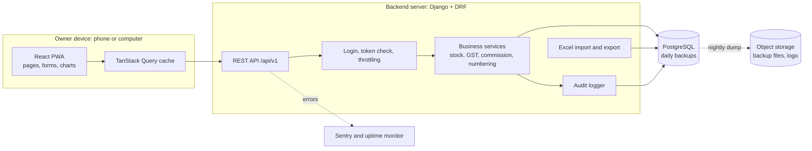

### 16.2 Deployment view

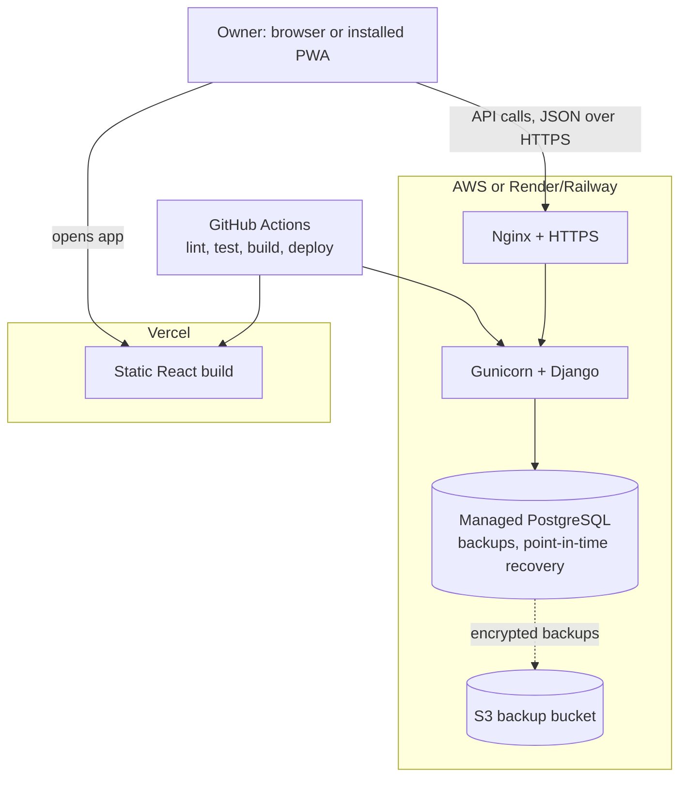

### 16.3 Site map (menus and pages)

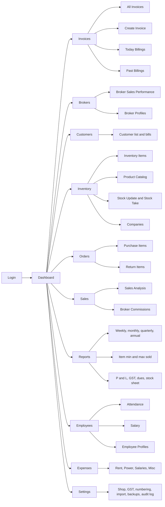

### 16.4 Data flow diagram, level 0 (who talks to the system)

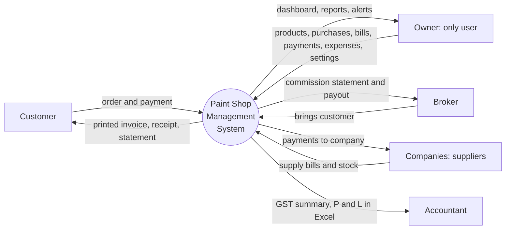

### 16.5 Data flow diagram, level 1 (processes and data stores)

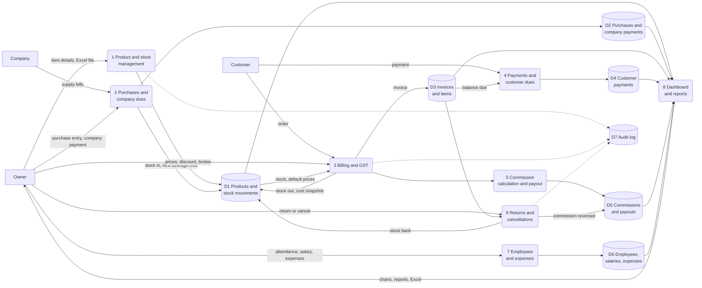

### 16.6 Entity relationship diagram: trading core

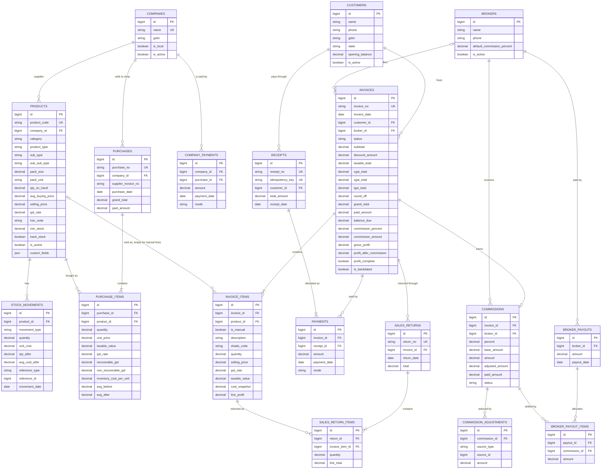

### 16.7 Entity relationship diagram: supporting tables

```mermaid
erDiagram
    EMPLOYEES ||--o{ ATTENDANCE : "marked daily"
    EMPLOYEES ||--o{ SALARIES : "paid monthly"
    SALARIES |o--o| EXPENSES : "creates expense when paid"
    EXPENSE_CATEGORIES ||--o{ EXPENSES : "groups"
    EXPENSE_CATEGORIES ||--o{ RECURRING_EXPENSES : "groups"
    STOCK_TAKES ||--|{ STOCK_TAKE_ITEMS : "contains"
    PRODUCTS ||--o{ STOCK_TAKE_ITEMS : "counted"
    PRODUCTS ||--o{ STOCK_SNAPSHOTS : "month-end value"
    USERS ||--o{ AUDIT_LOG : "actions recorded"

    EMPLOYEES {
        bigint id PK
        string name
        decimal base_salary
        date joining_date
        boolean is_active
    }
    ATTENDANCE {
        bigint id PK
        bigint employee_id FK
        date attendance_date
        string status
    }
    SALARIES {
        bigint id PK
        bigint employee_id FK
        string month
        decimal net_payable
        string status
        bigint expense_id FK
    }
    EXPENSE_CATEGORIES {
        bigint id PK
        string name UK
    }
    EXPENSES {
        bigint id PK
        bigint category_id FK
        decimal amount
        date expense_date
        string source
    }
    RECURRING_EXPENSES {
        bigint id PK
        bigint category_id FK
        decimal amount
        int day_of_month
    }
    STOCK_TAKES {
        bigint id PK
        string take_no UK
        date take_date
        string status
    }
    STOCK_TAKE_ITEMS {
        bigint id PK
        bigint take_id FK
        bigint product_id FK
        decimal system_qty
        decimal counted_qty
    }
    STOCK_SNAPSHOTS {
        bigint id PK
        date snapshot_date
        bigint product_id FK
        decimal qty
        decimal avg_cost
    }
    USERS {
        bigint id PK
        string username UK
        boolean is_active
    }
    AUDIT_LOG {
        bigint id PK
        datetime timestamp
        string action
        string entity_type
        bigint entity_id
        json before_json
        json after_json
    }
    APP_SETTINGS {
        bigint id PK
        string shop_name
        string gstin
        boolean prices_include_gst
        boolean purchase_gst_recoverable_default
    }
    GST_RATES {
        bigint id PK
        decimal rate UK
        boolean is_active
    }
    NUMBER_SERIES {
        bigint id PK
        string series_code
        string financial_year
        int last_number
    }
    IMPORT_JOBS {
        bigint id PK
        string entity
        string status
        int total_rows
        int error_rows
    }
    BACKUP_LOG {
        bigint id PK
        string backup_type
        string status
    }
```

### 16.8 Invoice creation flow (what happens on the billing screen)

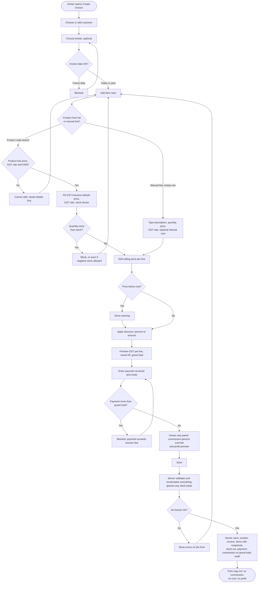

### 16.9 Invoice save: sequence between screen, server and database

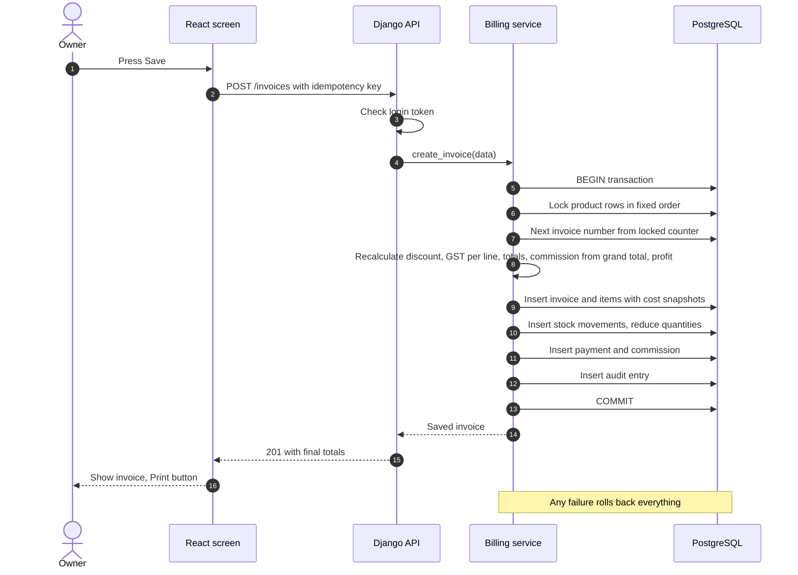

### 16.10 Purchase and weighted average cost

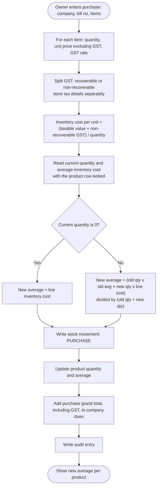

### 16.11 Sales return and invoice cancellation

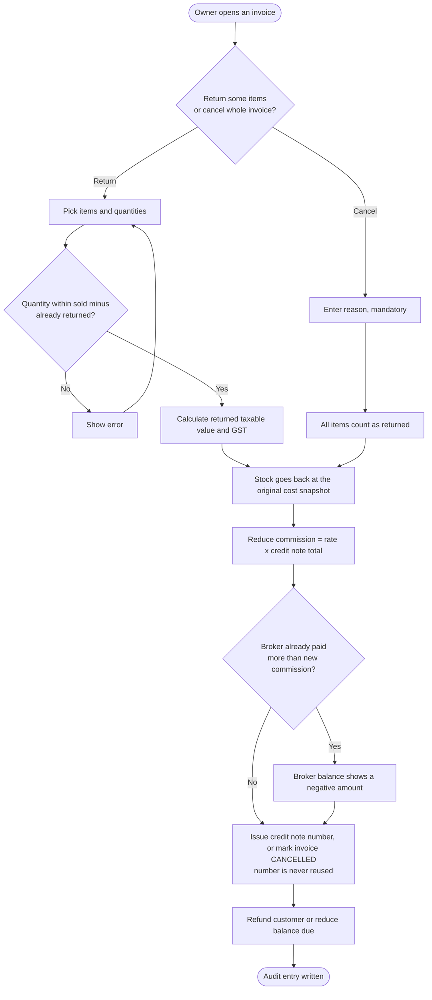

### 16.12 Status life cycles

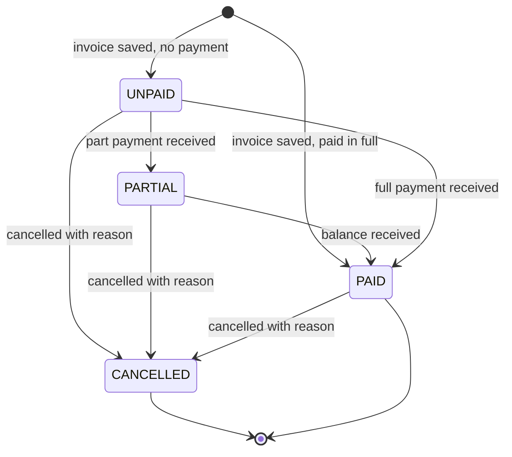

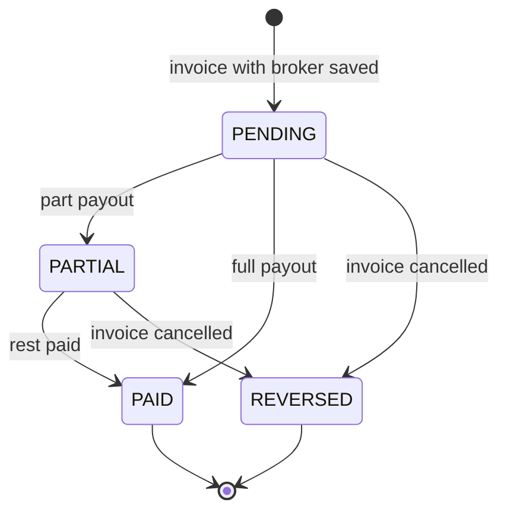

### 16.13 Excel import flow (product and opening stock)

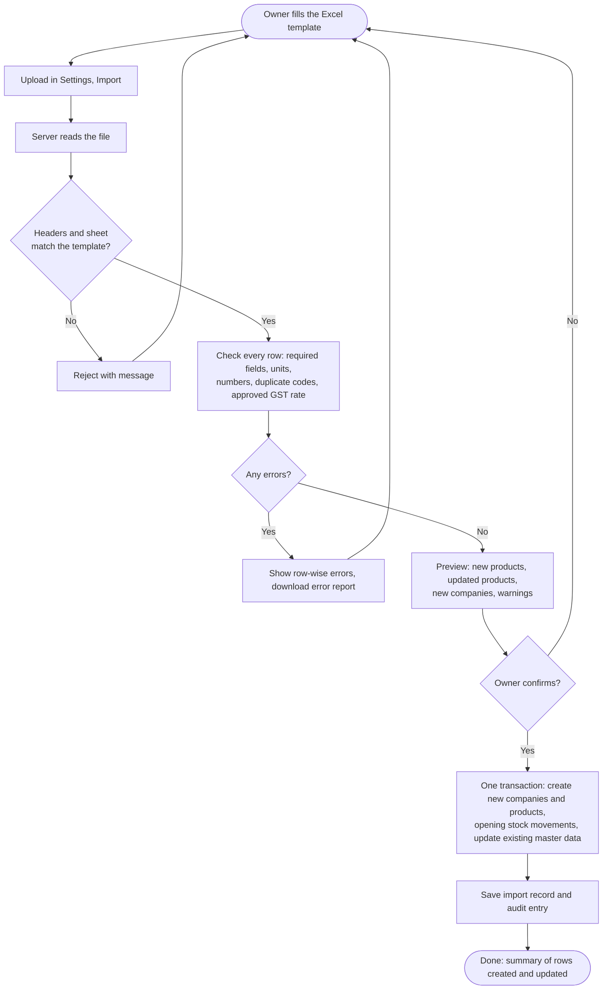

### 16.14 API map

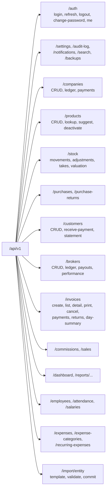

### 16.15 Login and token refresh

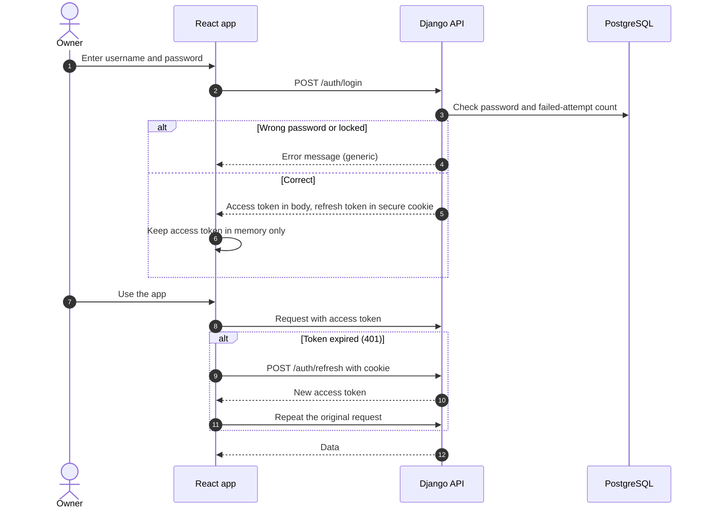

### 16.16 Roadmap timeline (single developer, about 20 weeks)

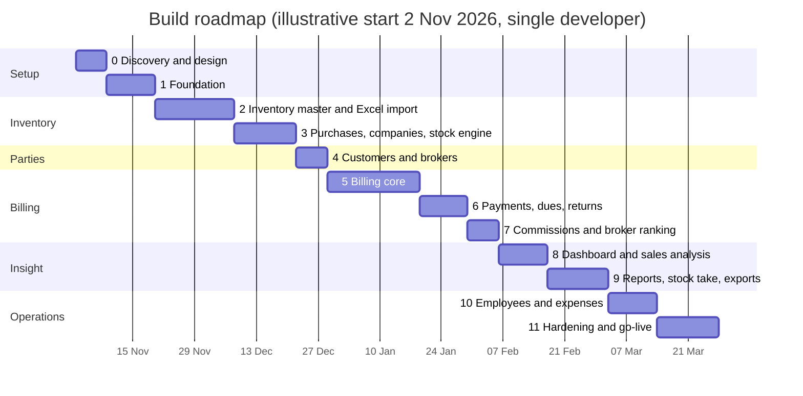

### 16.17 Screen wireframes (plain text)

**Overall layout (about 15% menu, 85% content)**

```
+----------------+--------------------------------------------------------------------+
| [Logo] SHOP    |  [Logo] Shop name   [Calendar]  [ Search........ ]  [+Invoice]     |
| NAME           |                                   [Yesterday] [Bell] [Theme] [Ram] |
+----------------+--------------------------------------------------------------------+
| Dashboard      |                                                                    |
| Invoices     > |                                                                    |
| Brokers      > |                  PAGE CONTENT (85%)                                |
| Customers      |                                                                    |
| Inventory    > |                                                                    |
| Orders       > |                                                                    |
| Sales        > |                                                                    |
| Reports      > |                                                                    |
| Employees    > |                                                                    |
| Expenses       |                                                                    |
| Settings       |                                                                    |
| Logout         |                                                                    |
+----------------+--------------------------------------------------------------------+
```

**Dashboard (as in the reference image)**

```
+--------------------------------------------------------------------+
| Overview                                                           |
| [Total Products] [Invoices] [Total Stock value] [Out of Stock (i)] |
+--------------------------------------------------------------------+
| [Total Customers] | [Pie: sold vs remaining stock] | [Top 10 Brokers] |
+-------------------+--------------------------------+  (bar list)     |
| [Expense vs Profit, last 6 months (area chart)]    |                 |
+----------------------------------------------------+-----------------+
| Optional strip: Today's sales | Today's profit | Customer dues | Commission pending |
+--------------------------------------------------------------------+
```

**Create Invoice**

```
+--------------------------------------------------------------------+
| Invoice No: Auto    Date: [23-10-2026]   Place of supply: [Telangana]|
| Customer: [search or + new......]     Broker: [search, optional.....]|
+--------------------------------------------------------------------+
| Code        | Item details         | Shade | Qty | Price | Disc | GST | Total |
| [type code] | company / type / sub | [   ] | [ ] | [ ]   | [ ]  | 18  | 0.00  |
| [type code] | ...                                                    |
| [manual line: description .......] | [ ] | [price] | [GST] | [cost?] |
| [+ add row]                                                         |
+---------------------------------------+----------------------------+
| Notes (internal)                      | Subtotal            0.00   |
|                                       | Discount  [% or Rs] 0.00   |
| OWNER ONLY (never printed)            | Taxable             0.00   |
| Broker commission %: [10]  Amount 0   | CGST / SGST         0.00   |
| Expected profit 0   After commission 0| Round-off           0.00   |
|                                       | GRAND TOTAL         0.00   |
| Payment received: [____] Mode: [Cash] | Balance due         0.00   |
+---------------------------------------+----------------------------+
|        [ Save ]    [ Save and Print ]    [ Save and New ]           |
+--------------------------------------------------------------------+
```

---

## 17. Future-Ready Design

You said more requirements will come later. The design keeps the cost of change low in these ways.

| Area | What is built in now | What it allows later |
|---|---|---|
| API-first | Every screen uses the same versioned REST API (`/api/v1`) with an auto-generated OpenAPI document | A native mobile app, a WhatsApp bot or an accountant tool can use the same API without backend changes |
| Versioning | New behaviour goes into `/api/v2` while v1 keeps working | Safe changes without breaking installed PWAs |
| Business rules in one place | All stock, GST, commission and numbering rules live in backend services (not in screens or database triggers) | Changing a rule means editing one service and its tests |
| Single stock entry point | All stock changes pass through one `StockService` | Adding branches or a godown later means extending this service and adding a stock location, with a documented migration |
| Users and roles | Login uses standard Django users and a central permission check; the shop runs with one owner now | Staff logins with limited permissions (billing only, view only) can be added without redesigning tables; audit log already records the actor |
| Custom fields | `custom_fields` (JSON) on products, customers, brokers and invoices | New information (warranty, vehicle number, site address) without a new table or migration |
| Settings in the database | Rates, rules, number formats and switches are settings, not code | Owner changes behaviour from the Settings screen |
| Controlled lists | Units, expense categories, payment modes are tables or lists | New unit or category without a release |
| Number series | Series table per document type and financial year | Quotation, delivery challan or purchase order series can be added |
| Import and export framework | One import wizard (validate, preview, commit) and one export layer | New Excel templates (customers, purchases, stock count) are configuration, not new screens |
| Background work slot | Imports, backups and reports run as simple commands today | A job queue (for email, WhatsApp, reminders) can be plugged in later |
| Document storage | Files (logo, backups, later invoice PDFs) go through a storage layer | Switch to S3, add attachments to purchases or expenses |
| Notifications | Alerts are computed by one notification service | Add WhatsApp or SMS reminders by adding a sender |
| Reports | Reports are defined as queries plus export, with date filters in one place | New reports are added quickly; heavy ones can use summary tables |
| Language | Screen texts are kept in one translation file | Telugu or other languages for screens and printed invoices later |
| Tests and migrations | Automated tests for money and stock logic; every database change is a versioned migration | Safe, repeatable changes |
| Monitoring and audit | Error tracking, uptime checks, append-only audit log | Faster diagnosis as the app grows |

**Likely future additions and where they would plug in:** staff logins (roles), quotations and estimates (new document type, same invoice engine), supplier purchase orders, branch or godown stock, WhatsApp invoice sharing, barcode scanning (the product code field already accepts scanner input), payment gateway or UPI QR on invoices, e-invoice integration, customer ledger statements by email, tinting machine records, and a native mobile app.

---

## 18. AI-Assisted Build Plan (pointer)

The project is built with AI coding assistants inside VS Code (OpenRouter free models through the Kilo extension). The full task-by-task plan is in the separate file **`ai-build-task-planner.md`**; the rules file **`AGENTS.md`** is placed in the project root so every task starts with the same non-negotiable rules.

Summary of the method:
1. **One small task at a time:** task, AI generates code, build and run, test, review, commit, then the next task.
2. **Backend and database first, frontend last.** The frontend is built only after the API is complete and documented (OpenAPI), then styled from design mockups (Figma AI or Claude Design) in a final design pass.
3. **Pure functions and tests first** for money, GST, stock and commission logic. The task planner marks these as **critical tasks** that need a second review and, where possible, a stronger model.
4. **Context packs:** each task attaches only the blueprint sections it needs (the blueprint is also supplied split by section) so small context windows and free-tier request limits are enough.
5. **Never share real customer or business data** with free endpoints; use sample data only.
